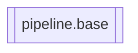

# `pipeline.base`

[← Index](../generated/module-index.md) · [Brain home](../README.md)

<!-- AUTO:START — sinh bởi scripts/brain_build.py 2026-11-11 13:00. Đừng sửa tay khối này. -->
**File:** `pipeline/base.py` · **Lớp:** `misc` · **124 dòng** (97 code) · **0 hàm**, **7 class** · sha1 `dd2c080bc1`

> pipeline/base.py — Stage + Gate tường minh (thay `server._auto_gpu` 300 dòng if/return). runner = Runner(STUDIO_PIPELINE) result = runner.run(ctx)        # → RunResult(status="done"|"park"|"hold"|"fail"|"stopped", ...)

### Phụ thuộc

- **Gọi tới (import nội bộ):** —
- **Được dùng bởi:** —
- **Test:** `tests/test_pipeline_runner.py`

### Hàm & class top-level

| Tên | Dòng | Dài | Tham số | Docstring |
|---|---:|---:|---|---|
| **class `Stopped`** | 19 | 0 method | | Người dùng bấm Dừng. |
| **class `Context`** | 24 | 1 method | |  |
| **class `GateResult`** | 38 | 4 method | |  |
| **class `Stage`** | 61 | 2 method | |  |
| **class `Gate`** | 71 | 1 method | |  |
| **class `RunResult`** | 79 | 1 method | |  |
| **class `Runner`** | 92 | 2 method | |  |

**Tín hiệu rủi ro (đếm tĩnh):** broad_except=1

### Lịch sử (từ docs/)

- Fix logs: —
- Nhắc trong CHANGELOG: **0** lần · DECISIONS: **0** lần

<!-- AUTO:END -->

<!-- MANUAL:START -->
## Vai trò (viết tay)

_Chưa viết. 2–4 câu: module này chịu trách nhiệm gì trong pipeline, ai gọi nó, nó KHÔNG làm gì._

## Luồng chính

_Các hàm vào (entry) → bước chính → output/side effect. Ghi tên hàm thật._

## Bất biến & hợp đồng

_Điều luôn phải đúng (vd: chỉ ghi manifest qua `Manifest.update`; 1 job / ghế). Vi phạm = bug._

## Bẫy đã biết

_Lỗi từng gặp + link `docs/fixes/...`. Những chỗ dễ sửa sai._

## Ghi chú vận hành

_Config key quan trọng, cần restart gì khi sửa (:8801 / :8802 / hot-reload), cách test._
<!-- MANUAL:END -->
