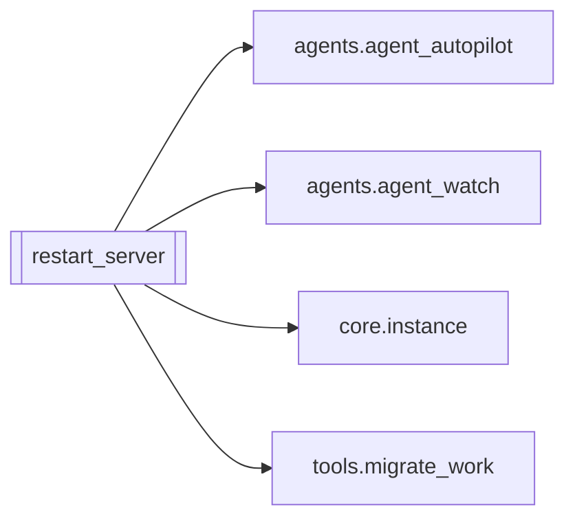

# `restart_server`

[← Index](../generated/module-index.md) · [Brain home](../README.md)

<!-- AUTO:START — sinh bởi scripts/brain_build.py 2026-11-11 13:00. Đừng sửa tay khối này. -->
**File:** `restart_server.py` · **Lớp:** `control` · **319 dòng** (265 code) · **13 hàm**, **0 class** · sha1 `2dfa69caef`

> Restart server Pineline (giữ sidecar), khôi phục hàng đợi + Auto-pilot. Instance: `--instance <tên>` (hoặc env PINELINE_INSTANCE, mặc định v6) → cổng/work/sidecar lấy từ instances/<tên>.json (apply_env). review2: env POR

### Phụ thuộc

- **Gọi tới (import nội bộ):** [agents.agent_autopilot](./agents.agent_autopilot.md), [agents.agent_watch](./agents.agent_watch.md), [core.instance](./core.instance.md), [tools.migrate_work](./tools.migrate_work.md)
- **Được dùng bởi:** —
- **Được nhắc tên file `.py` (subprocess/script) bởi:** [agents.agent_tele_cmd](./agents.agent_tele_cmd.md)
- **Test:** ❌ chưa có test import trực tiếp

### Hàm & class top-level

| Tên | Dòng | Dài | Tham số | Docstring |
|---|---:|---:|---|---|
| `_pre_instance` | 35 | 8 | `argv` | Tên instance từ argv (`--instance X` / `--instance=X`) → env PINELINE_INSTANCE → v6. |
| `_manifest_opts` | 90 | 6 | `job_id` |  |
| `_tg` | 98 | 10 | `msg` |  |
| `_server_procs` | 110 | 3 | `` | Backend CỦA instance này (cwd = cây này + token cổng/instance khớp) — không bao giờ server V2. |
| `_sidecar_procs` | 115 | 2 | `` |  |
| `_proc_env` | 119 | 7 | `procs` |  |
| `_precheck` | 128 | 11 | `` | '' nếu code mới compile + import được; ngược lại là lỗi (không restart). |
| `_job_parked` | 141 | 7 | `job_id` |  |
| `_requeue` | 150 | 13 | `order, opts` |  |
| `_start_server` | 165 | 14 | `clean_env, env` |  |
| `_restart_sidecar` | 181 | 8 | `env` |  |
| `guard_ports` | 191 | 7 | `inst, allow_foreign` | '' nếu được phép restart; ngược lại lý do từ chối (cổng thuộc tiến trình ngoài V6). |
| `main` | 200 | 110 | `` |  |

### Config / env keys (5)

`AGENT_TELEGRAM`, `PINELINE_INSTANCE`, `PINELINE_LEGACY_START`, `PORT`, `WORK_DIR`

**File/artifact nhắc tới:** `manifest.json`, `restart_pending.json`

**Tín hiệu rủi ro (đếm tĩnh):** broad_except=6 · file_writes=1 · sleep=5 · subprocess=3

### Lịch sử (từ docs/)

- **Fix logs (1):**
  - [2026-11-11 — F4 (services + sidecar thuần) + F5 (render tiến trình con)](../../fixes/2026-11-11-f4-f5.md)
- **Reviews:** [2026-11-11-review-f4-f5](../../reviews/2026-11-11-review-f4-f5.md)
- Nhắc trong CHANGELOG: **0** lần · DECISIONS: **0** lần

<!-- AUTO:END -->

<!-- MANUAL:START -->
## Vai trò (viết tay)

_Chưa viết. 2–4 câu: module này chịu trách nhiệm gì trong pipeline, ai gọi nó, nó KHÔNG làm gì._

## Luồng chính

_Các hàm vào (entry) → bước chính → output/side effect. Ghi tên hàm thật._

## Bất biến & hợp đồng

_Điều luôn phải đúng (vd: chỉ ghi manifest qua `Manifest.update`; 1 job / ghế). Vi phạm = bug._

## Bẫy đã biết

_Lỗi từng gặp + link `docs/fixes/...`. Những chỗ dễ sửa sai._

## Ghi chú vận hành

_Config key quan trọng, cần restart gì khi sửa (:8801 / :8802 / hot-reload), cách test._
<!-- MANUAL:END -->
