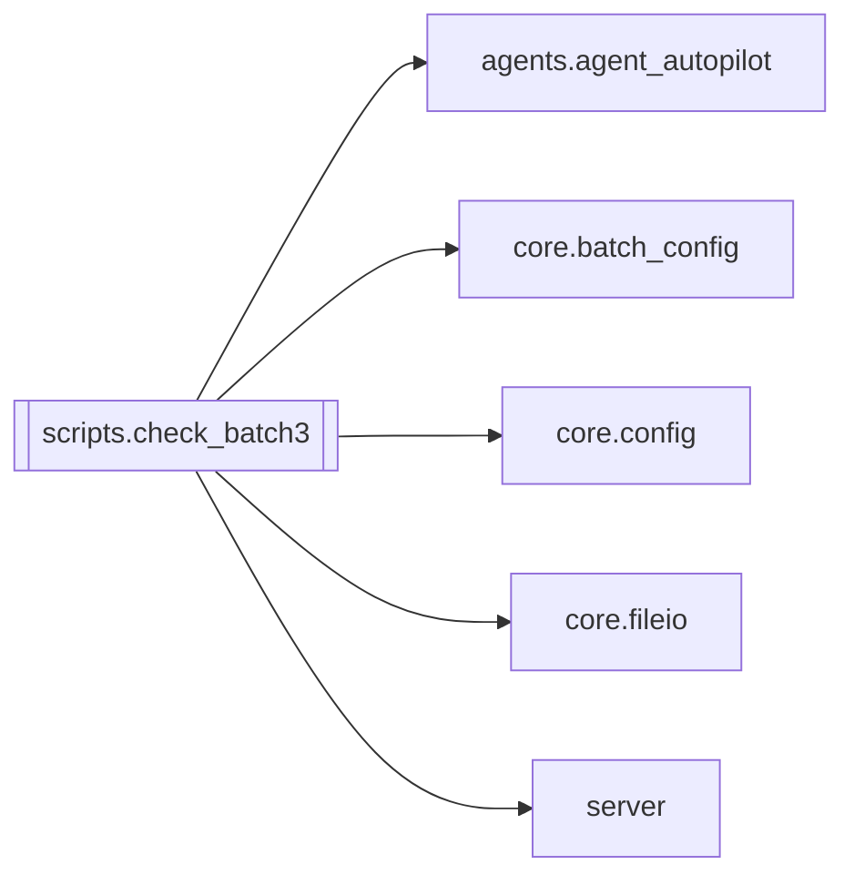

# `scripts.check_batch3`

[← Index](../generated/module-index.md) · [Brain home](../README.md)

<!-- AUTO:START — sinh bởi scripts/brain_build.py 2026-11-11 13:00. Đừng sửa tay khối này. -->
**File:** `scripts/check_batch3.py` · **Lớp:** `ops` · **202 dòng** (174 code) · **1 hàm**, **0 class** · sha1 `4904c15384`

> Kiểm thử đợt 3 (opts một nguồn X1, config file-first X2, ghi nguyên tử + khoá S13). Chạy trên file tạm; import server như pytest (không nạp hàng đợi thật).

### Phụ thuộc

- **Gọi tới (import nội bộ):** [agents.agent_autopilot](./agents.agent_autopilot.md), [core.batch_config](./core.batch_config.md), [core.config](./core.config.md), [core.fileio](./core.fileio.md), [server](./server.md)
- **Được dùng bởi:** —
- **Test:** ❌ chưa có test import trực tiếp
- **Thư viện ngoài:** `fastapi`, `pytest`

### Hàm & class top-level

| Tên | Dòng | Dài | Tham số | Docstring |
|---|---:|---:|---|---|
| `check` | 20 | 4 | `name, cond` |  |

### Config / env keys (3)

`LLM_MODEL`, `ZZ_ENVSET`, `ZZ_FROMFILE`

**Cổng nhắc tới:** 8801

**File/artifact nhắc tới:** `a.json`, `autopilot_state.json`, `batch_config.json`, `batch_config2.json`, `cnt.txt`, `manifest.json`, `pineline.config.json`, `s.json`

**Tín hiệu rủi ro (đếm tĩnh):** file_writes=7 · global_stmt=1 · subprocess=1 · threads=2

### Lịch sử (từ docs/)

- Fix logs: —
- Nhắc trong CHANGELOG: **0** lần · DECISIONS: **0** lần

<!-- AUTO:END -->

<!-- MANUAL:START -->
## Vai trò (viết tay)

_Chưa viết. 2–4 câu: module này chịu trách nhiệm gì trong pipeline, ai gọi nó, nó KHÔNG làm gì._

## Luồng chính

_Các hàm vào (entry) → bước chính → output/side effect. Ghi tên hàm thật._

## Bất biến & hợp đồng

_Điều luôn phải đúng (vd: chỉ ghi manifest qua `Manifest.update`; 1 job / ghế). Vi phạm = bug._

## Bẫy đã biết

_Lỗi từng gặp + link `docs/fixes/...`. Những chỗ dễ sửa sai._

## Ghi chú vận hành

_Config key quan trọng, cần restart gì khi sửa (:8801 / :8802 / hot-reload), cách test._
<!-- MANUAL:END -->
