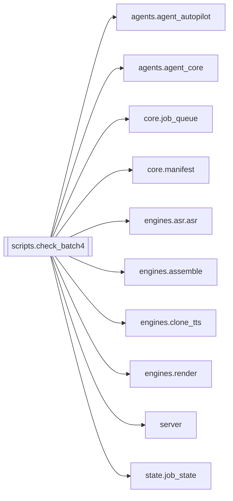

# `scripts.check_batch4`

[← Index](../generated/module-index.md) · [Brain home](../README.md)

<!-- AUTO:START — sinh bởi scripts/brain_build.py 2026-11-11 13:00. Đừng sửa tay khối này. -->
**File:** `scripts/check_batch4.py` · **Lớp:** `ops` · **458 dòng** (374 code) · **6 hàm**, **2 class** · sha1 `69d796760d`

> Kiểm thử đợt 4 (tranh chấp ghi manifest, claim endpoint, single-instance, worker khởi động). Chạy trên thư mục tạm; import server như pytest (không nạp hàng đợi thật).

### Phụ thuộc

- **Gọi tới (import nội bộ):** [agents.agent_autopilot](./agents.agent_autopilot.md), [agents.agent_core](./agents.agent_core.md), [core.job_queue](./core.job_queue.md), [core.manifest](./core.manifest.md), [engines.asr.asr](./engines.asr.asr.md), [engines.assemble](./engines.assemble.md), [engines.clone_tts](./engines.clone_tts.md), [engines.render](./engines.render.md), [server](./server.md), [state.job_state](./state.job_state.md)
- **Được dùng bởi:** —
- **Test:** ❌ chưa có test import trực tiếp
- **Thư viện ngoài:** `psutil`, `pytest`, `state`

### Hàm & class top-level

| Tên | Dòng | Dài | Tham số | Docstring |
|---|---:|---:|---|---|
| **class `M`** | 322 | 1 method | |  |
| **class `_Boom`** | 417 | 0 method | |  |
| `check` | 20 | 4 | `name, cond` |  |
| `fake_post` | 260 | 3 | `base, path, body, timeout` |  |
| `fake_baf` | 311 | 3 | `cmd, work_dir, dub, nv, voc, audio_mode, vv, ov` |  |
| `fake_ff` | 316 | 4 | `cmd, total, m, cwd, hi` |  |
| `mk_wav` | 351 | 6 | `p, sec, sr` |  |
| `fake_worker` | 421 | 3 | `engine, ref, ref_text, out_dir, speed, todo, on_prog` |  |

**File/artifact nhắc tới:** `.server_test.lock`, `.sidecar_18902.lock`, `_keys.json`, `_vieneu_job.json`, `audio.partial.wav`, `audio.wav`, `audio.wav.json`, `dub.wav`, `dub_fit.partial.wav`, `dub_fit.wav`, `manifest.json`, `mixed_audio.json`, `no_vocals.wav`, `ref.wav`, `script.json`, `seg_0000.wav`, `seg_0001.wav`, `source.m4a`, `tts.json`, `tts_config.json`, `v.mp4`, `vocals.wav`

**Tín hiệu rủi ro (đếm tĩnh):** broad_except=1 · file_writes=11 · global_stmt=1 · subprocess=5

### Lịch sử (từ docs/)

- Fix logs: —
- Nhắc trong CHANGELOG: **0** lần · DECISIONS: **0** lần

<!-- AUTO:END -->

<!-- MANUAL:START -->
## Vai trò (viết tay)

_Chưa viết. 2–4 câu: module này chịu trách nhiệm gì trong pipeline, ai gọi nó, nó KHÔNG làm gì._

## Luồng chính

_Các hàm vào (entry) → bước chính → output/side effect. Ghi tên hàm thật._

## Bất biến & hợp đồng

_Điều luôn phải đúng (vd: chỉ ghi manifest qua `Manifest.update`; 1 job / ghế). Vi phạm = bug._

## Bẫy đã biết

_Lỗi từng gặp + link `docs/fixes/...`. Những chỗ dễ sửa sai._

## Ghi chú vận hành

_Config key quan trọng, cần restart gì khi sửa (:8801 / :8802 / hot-reload), cách test._
<!-- MANUAL:END -->
