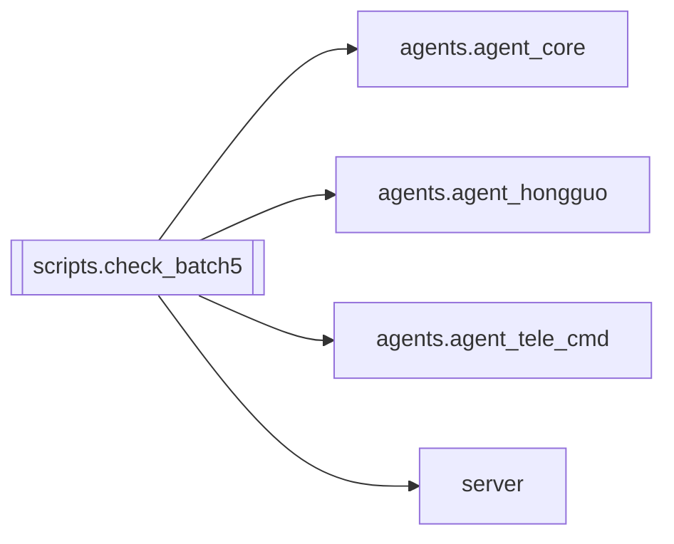

# `scripts.check_batch5`

[← Index](../generated/module-index.md) · [Brain home](../README.md)

<!-- AUTO:START — sinh bởi scripts/brain_build.py 2026-11-11 13:00. Đừng sửa tay khối này. -->
**File:** `scripts/check_batch5.py` · **Lớp:** `ops` · **347 dòng** (293 code) · **6 hàm**, **0 class** · sha1 `81925b4648`

> Kiểm thử đợt 5 (agent an toàn): lệnh / bắt buộc, phân tầng tool + xác nhận ✅/❌, hg_auto_flow mode + chạy nền chống trùng, cắt kết quả tool, /stop không bị chặn. Không gọi LLM / Telegram / Hongguo thật — mọi I/O ngoài đều

### Phụ thuộc

- **Gọi tới (import nội bộ):** [agents.agent_core](./agents.agent_core.md), [agents.agent_hongguo](./agents.agent_hongguo.md), [agents.agent_tele_cmd](./agents.agent_tele_cmd.md), [server](./server.md)
- **Được dùng bởi:** —
- **Test:** ❌ chưa có test import trực tiếp
- **Thư viện ngoài:** `fastapi`, `pytest`

### Hàm & class top-level

| Tên | Dòng | Dài | Tham số | Docstring |
|---|---:|---:|---|---|
| `check` | 20 | 4 | `name, cond` |  |
| `_fake_pick` | 45 | 3 | `items, target` |  |
| `_slow_flow` | 73 | 4 | `target, **kw` |  |
| `_script` | 173 | 3 | `turns` |  |
| `_fake_run` | 241 | 3 | `msg, **kw` |  |
| `_fake_chat` | 308 | 3 | `base, msg, **kw` |  |

**Cổng nhắc tới:** 8801

**Tín hiệu rủi ro (đếm tĩnh):** global_stmt=1 · sleep=2

### Lịch sử (từ docs/)

- Fix logs: —
- Nhắc trong CHANGELOG: **0** lần · DECISIONS: **0** lần

<!-- AUTO:END -->

<!-- MANUAL:START -->
## Vai trò (viết tay)

_Chưa viết. 2–4 câu: module này chịu trách nhiệm gì trong pipeline, ai gọi nó, nó KHÔNG làm gì._

## Luồng chính

_Các hàm vào (entry) → bước chính → output/side effect. Ghi tên hàm thật._

## Bất biến & hợp đồng

_Điều luôn phải đúng (vd: chỉ ghi manifest qua `Manifest.update`; 1 job / ghế). Vi phạm = bug._

## Bẫy đã biết

_Lỗi từng gặp + link `docs/fixes/...`. Những chỗ dễ sửa sai._

## Ghi chú vận hành

_Config key quan trọng, cần restart gì khi sửa (:8801 / :8802 / hot-reload), cách test._
<!-- MANUAL:END -->
