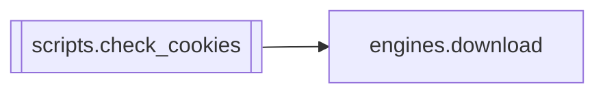

# `scripts.check_cookies`

[← Index](../generated/module-index.md) · [Brain home](../README.md)

<!-- AUTO:START — sinh bởi scripts/brain_build.py 2026-11-11 13:00. Đừng sửa tay khối này. -->
**File:** `scripts/check_cookies.py` · **Lớp:** `ops` · **172 dòng** (142 code) · **5 hàm**, **0 class** · sha1 `674ef50398`

> check_cookies.py — Soi file cookie: còn hạn không, đã ĐĂNG NHẬP chưa, và có lấy được HD không. Trả lời trực tiếp câu "vì sao video HD tải không được". Port & tổng quát hóa từ test_cookies.py (Galaxy). Khác bản gốc: không

### Phụ thuộc

- **Gọi tới (import nội bộ):** [engines.download](./engines.download.md)
- **Được dùng bởi:** —
- **Test:** ❌ chưa có test import trực tiếp
- **Thư viện ngoài:** `yt_dlp`

### Hàm & class top-level

| Tên | Dòng | Dài | Tham số | Docstring |
|---|---:|---:|---|---|
| `inspect_expiry` | 40 | 27 | `cookie_file` | In từng cookie kèm hạn dùng. Trả (tổng, hết hạn, session). |
| `check_login` | 69 | 15 | `cookie_file, platform` | Có token đăng nhập không? |
| `max_resolution` | 86 | 12 | `url, cookie_file` | Trả (max_height, title) mà yt-dlp thấy được với/không cookie. |
| `run` | 100 | 58 | `platform, cookie_file, cookies_dir, url` |  |
| `main` | 160 | 9 | `argv` |  |

**Tín hiệu rủi ro (đếm tĩnh):** broad_except=2

### Lịch sử (từ docs/)

- Fix logs: —
- Nhắc trong CHANGELOG: **0** lần · DECISIONS: **0** lần

<!-- AUTO:END -->

<!-- MANUAL:START -->
## Vai trò (viết tay)

_Chưa viết. 2–4 câu: module này chịu trách nhiệm gì trong pipeline, ai gọi nó, nó KHÔNG làm gì._

## Luồng chính

_Các hàm vào (entry) → bước chính → output/side effect. Ghi tên hàm thật._

## Bất biến & hợp đồng

_Điều luôn phải đúng (vd: chỉ ghi manifest qua `Manifest.update`; 1 job / ghế). Vi phạm = bug._

## Bẫy đã biết

_Lỗi từng gặp + link `docs/fixes/...`. Những chỗ dễ sửa sai._

## Ghi chú vận hành

_Config key quan trọng, cần restart gì khi sửa (:8801 / :8802 / hot-reload), cách test._
<!-- MANUAL:END -->
