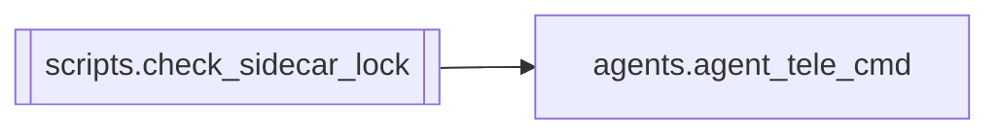

# `scripts.check_sidecar_lock`

[← Index](../generated/module-index.md) · [Brain home](../README.md)

<!-- AUTO:START — sinh bởi scripts/brain_build.py 2026-11-11 13:00. Đừng sửa tay khối này. -->
**File:** `scripts/check_sidecar_lock.py` · **Lớp:** `ops` · **33 dòng** (30 code) · **0 hàm**, **0 class** · sha1 `b3c0658c8b`

### Phụ thuộc

- **Gọi tới (import nội bộ):** [agents.agent_tele_cmd](./agents.agent_tele_cmd.md)
- **Được dùng bởi:** —
- **Được nhắc tên file `.py` (subprocess/script) bởi:** [scripts.check_batch4](./scripts.check_batch4.md)
- **Test:** ❌ chưa có test import trực tiếp

### Config / env keys (1)

`AUTOPILOT_PORT`

**Tín hiệu rủi ro (đếm tĩnh):** subprocess=1

### Lịch sử (từ docs/)

- Fix logs: —
- Nhắc trong CHANGELOG: **0** lần · DECISIONS: **0** lần

<!-- AUTO:END -->

<!-- MANUAL:START -->
## Vai trò (viết tay)

_Chưa viết. 2–4 câu: module này chịu trách nhiệm gì trong pipeline, ai gọi nó, nó KHÔNG làm gì._

## Luồng chính

_Các hàm vào (entry) → bước chính → output/side effect. Ghi tên hàm thật._

## Bất biến & hợp đồng

_Điều luôn phải đúng (vd: chỉ ghi manifest qua `Manifest.update`; 1 job / ghế). Vi phạm = bug._

## Bẫy đã biết

_Lỗi từng gặp + link `docs/fixes/...`. Những chỗ dễ sửa sai._

## Ghi chú vận hành

_Config key quan trọng, cần restart gì khi sửa (:8801 / :8802 / hot-reload), cách test._
<!-- MANUAL:END -->
