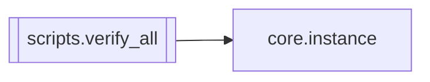

# `scripts.verify_all`

[← Index](../generated/module-index.md) · [Brain home](../README.md)

<!-- AUTO:START — sinh bởi scripts/brain_build.py 2026-11-11 13:00. Đừng sửa tay khối này. -->
**File:** `scripts/verify_all.py` · **Lớp:** `ops` · **371 dòng** (318 code) · **12 hàm**, **1 class** · sha1 `7ccb73123a`

> scripts/verify_all.py — kiểm toàn bộ V6 MỘT LẦN trên máy Windows (gọi từ verify_all.bat ở gốc cây). KHÔNG chạy job thật, KHÔNG GPU/LLM, KHÔNG gọi cổng V2 (:8801/:8802), :8000, :8083. Chỉ dùng instance `test` (cổng 8899, 

### Phụ thuộc

- **Gọi tới (import nội bộ):** [core.instance](./core.instance.md)
- **Được dùng bởi:** —
- **Test:** ❌ chưa có test import trực tiếp
- **Thư viện ngoài:** `fastapi`, `psutil`, `uvicorn`

### Hàm & class top-level

| Tên | Dòng | Dài | Tham số | Docstring |
|---|---:|---:|---|---|
| **class `Log`** | 50 | 3 method | | In ra màn hình + ghi file log (UTF-8). |
| `_env` | 70 | 9 | `` |  |
| `run_cmd` | 81 | 31 | `log, cmd, timeout, dry` |  |
| `step_pytest_v6` | 116 | 4 | `log, dry` |  |
| `step_pytest_v5` | 122 | 4 | `log, dry` |  |
| `step_tree_audit` | 128 | 4 | `log, dry` |  |
| `check_test_instance` | 136 | 19 | `` | instances/test.json phải: cổng 8899 (không cổng V2), work ./scratch/test_work, mọi cờ gọi ra ngoài tắt. |
| `port_open` | 157 | 6 | `port, host` |  |
| `http_get` | 169 | 9 | `url, timeout` |  |
| `read_sse` | 180 | 18 | `url, seconds` | Đọc luồng SSE tối đa `seconds` giây (dừng sớm khi đã thấy snapshot). |
| `kill_backend` | 200 | 26 | `p, log` | Tắt ĐÚNG tiến trình đã khởi (+ con của nó). Không đụng python khác. |
| `step_smoke` | 228 | 87 | `log, dry, backend_cmd, port, wait_sec` | Trả (trạng thái, ghi chú, danh sách kiểm con). |
| `main` | 327 | 41 | `argv` |  |

**File/artifact nhắc tới:** `verify_all_backend.log`

**Tín hiệu rủi ro (đếm tĩnh):** broad_except=1 · file_writes=1 · sleep=2 · subprocess=3 · swallow_except=1 · threads=1

### Lịch sử (từ docs/)

- Fix logs: —
- Nhắc trong CHANGELOG: **0** lần · DECISIONS: **0** lần

<!-- AUTO:END -->

<!-- MANUAL:START -->
## Vai trò (viết tay)

_Chưa viết. 2–4 câu: module này chịu trách nhiệm gì trong pipeline, ai gọi nó, nó KHÔNG làm gì._

## Luồng chính

_Các hàm vào (entry) → bước chính → output/side effect. Ghi tên hàm thật._

## Bất biến & hợp đồng

_Điều luôn phải đúng (vd: chỉ ghi manifest qua `Manifest.update`; 1 job / ghế). Vi phạm = bug._

## Bẫy đã biết

_Lỗi từng gặp + link `docs/fixes/...`. Những chỗ dễ sửa sai._

## Ghi chú vận hành

_Config key quan trọng, cần restart gì khi sửa (:8801 / :8802 / hot-reload), cách test._
<!-- MANUAL:END -->
