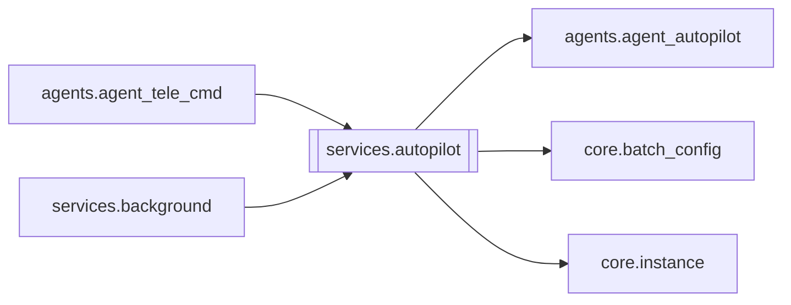

# `services.autopilot`

[← Index](../generated/module-index.md) · [Brain home](../README.md)

<!-- AUTO:START — sinh bởi scripts/brain_build.py 2026-11-11 13:00. Đừng sửa tay khối này. -->
**File:** `services/autopilot.py` · **Lớp:** `misc` · **79 dòng** (67 code) · **4 hàm**, **0 class** · sha1 `7fdbc8f269`

> services/autopilot.py — vòng Auto-pilot + config-live (sidecar cũ: autopilot_loop / config_watch_loop) — V6 F4. Chuyển nguyên văn từ agents/agent_tele_cmd.py; `base` = server của instance, `notify` do bên gọi truyền (ser

### Phụ thuộc

- **Gọi tới (import nội bộ):** [agents.agent_autopilot](./agents.agent_autopilot.md), [core.batch_config](./core.batch_config.md), [core.instance](./core.instance.md)
- **Được dùng bởi:** [agents.agent_tele_cmd](./agents.agent_tele_cmd.md), [services.background](./services.background.md)
- **Test:** `tests/test_review2_f4f5.py`

### Hàm & class top-level

| Tên | Dòng | Dài | Tham số | Docstring |
|---|---:|---:|---|---|
| `_base` | 17 | 5 | `base` |  |
| `autopilot_loop` | 24 | 24 | `stop, base, notify, tick_sec` |  |
| `sync_and_report` | 50 | 12 | `reason, base, notify` |  |
| `config_watch_loop` | 64 | 16 | `stop, base, notify` |  |

### Config / env keys (2)

`AUTOPILOT_TICK_SEC`, `QUEUE_LIVE_CONFIG`

**Tín hiệu rủi ro (đếm tĩnh):** broad_except=2

### Lịch sử (từ docs/)

- **Fix logs (1):**
  - [2026-11-11 — F4 (services + sidecar thuần) + F5 (render tiến trình con)](../../fixes/2026-11-11-f4-f5.md)
- Nhắc trong CHANGELOG: **0** lần · DECISIONS: **0** lần

<!-- AUTO:END -->

<!-- MANUAL:START -->
## Vai trò (viết tay)

_Chưa viết. 2–4 câu: module này chịu trách nhiệm gì trong pipeline, ai gọi nó, nó KHÔNG làm gì._

## Luồng chính

_Các hàm vào (entry) → bước chính → output/side effect. Ghi tên hàm thật._

## Bất biến & hợp đồng

_Điều luôn phải đúng (vd: chỉ ghi manifest qua `Manifest.update`; 1 job / ghế). Vi phạm = bug._

## Bẫy đã biết

_Lỗi từng gặp + link `docs/fixes/...`. Những chỗ dễ sửa sai._

## Ghi chú vận hành

_Config key quan trọng, cần restart gì khi sửa (:8801 / :8802 / hot-reload), cách test._
<!-- MANUAL:END -->
