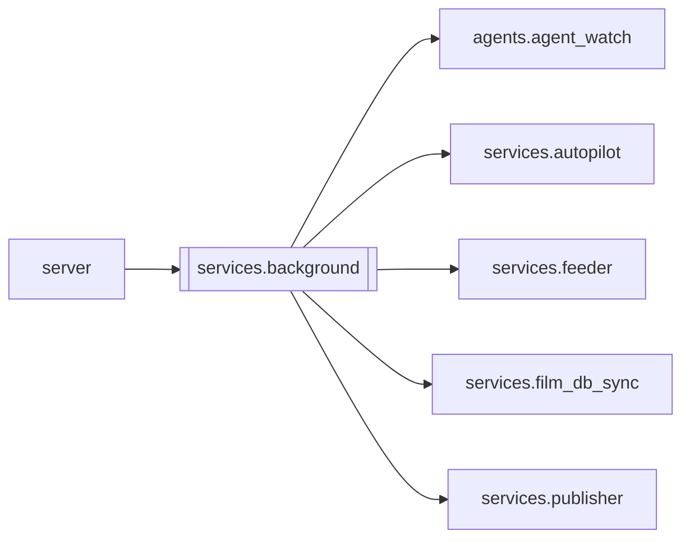

# `services.background`

[← Index](../generated/module-index.md) · [Brain home](../README.md)

<!-- AUTO:START — sinh bởi scripts/brain_build.py 2026-11-11 13:00. Đừng sửa tay khối này. -->
**File:** `services/background.py` · **Lớp:** `misc` · **73 dòng** (56 code) · **5 hàm**, **0 class** · sha1 `c7a9b6049f`

> services/background.py — khởi động việc nền TRONG server khi instance bật cờ `feeder` (V6 F4). Gồm: autopilot tick, config-live, runwatch, feeder, film_db sync (+ worker auto-publish nếu cờ auto_publish). Trước đây toàn 

### Phụ thuộc

- **Gọi tới (import nội bộ):** [agents.agent_watch](./agents.agent_watch.md), [services.autopilot](./services.autopilot.md), [services.feeder](./services.feeder.md), [services.film_db_sync](./services.film_db_sync.md), [services.publisher](./services.publisher.md)
- **Được dùng bởi:** [server](./server.md)
- **Được nhắc tên file `.py` (subprocess/script) bởi:** [server](./server.md)
- **Test:** `tests/test_f4_services.py`, `tests/test_review2_f4f5.py`
- **Thư viện ngoài:** `services`

### Hàm & class top-level

| Tên | Dòng | Dài | Tham số | Docstring |
|---|---:|---:|---|---|
| `enabled` | 20 | 2 | `` |  |
| `_notify` | 24 | 7 | `text, force` | Telegram qua agents.agent_watch.telegram_send — tự tắt khi instance telegram=false (AGENT_TELEGRAM=0). |
| `_targets` | 33 | 11 | `base` |  |
| `start` | 46 | 24 | `base, delay, force` | Khởi động các vòng (1 lần / tiến trình). Trả tên vòng đã chạy; [] nếu cờ tắt. |
| `stop` | 72 | 2 | `` |  |

### Config / env keys (1)

`PINELINE_FLAG_FEEDER`

**Tín hiệu rủi ro (đếm tĩnh):** broad_except=1 · threads=1

### Lịch sử (từ docs/)

- **Fix logs (1):**
  - [2026-11-11 — F4 (services + sidecar thuần) + F5 (render tiến trình con)](../../fixes/2026-11-11-f4-f5.md)
- **Reviews:** [2026-11-11-review-f4-f5](../../reviews/2026-11-11-review-f4-f5.md)
- Nhắc trong CHANGELOG: **0** lần · DECISIONS: **0** lần

<!-- AUTO:END -->

<!-- MANUAL:START -->
## Vai trò (viết tay)

_Chưa viết. 2–4 câu: module này chịu trách nhiệm gì trong pipeline, ai gọi nó, nó KHÔNG làm gì._

## Luồng chính

_Các hàm vào (entry) → bước chính → output/side effect. Ghi tên hàm thật._

## Bất biến & hợp đồng

_Điều luôn phải đúng (vd: chỉ ghi manifest qua `Manifest.update`; 1 job / ghế). Vi phạm = bug._

## Bẫy đã biết

_Lỗi từng gặp + link `docs/fixes/...`. Những chỗ dễ sửa sai._

## Ghi chú vận hành

_Config key quan trọng, cần restart gì khi sửa (:8801 / :8802 / hot-reload), cách test._
<!-- MANUAL:END -->
