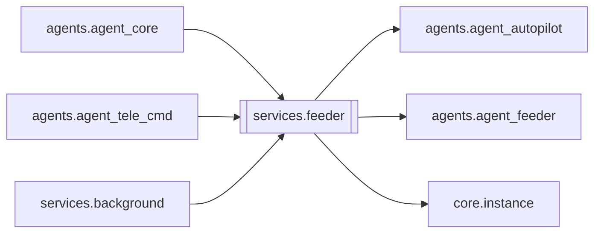

# `services.feeder`

[← Index](../generated/module-index.md) · [Brain home](../README.md)

<!-- AUTO:START — sinh bởi scripts/brain_build.py 2026-11-11 13:00. Đừng sửa tay khối này. -->
**File:** `services/feeder.py` · **Lớp:** `misc` · **120 dòng** (95 code) · **8 hàm**, **0 class** · sha1 `b577fcde9b`

> services/feeder.py — Feeder / Run-watch / thư viện (V6 F4): lớp mỏng trên agents.agent_feeder. Trước: agent_core (trong server) POST sidecar `/cmd` "/running" | "/lib …" | "/feed …" → sidecar gọi agents.agent_feeder(BASE

### Phụ thuộc

- **Gọi tới (import nội bộ):** [agents.agent_autopilot](./agents.agent_autopilot.md), [agents.agent_feeder](./agents.agent_feeder.md), [core.instance](./core.instance.md)
- **Được dùng bởi:** [agents.agent_core](./agents.agent_core.md), [agents.agent_tele_cmd](./agents.agent_tele_cmd.md), [services.background](./services.background.md)
- **Test:** `tests/test_f4_services.py`

### Hàm & class top-level

| Tên | Dòng | Dài | Tham số | Docstring |
|---|---:|---:|---|---|
| `_base` | 16 | 5 | `base` |  |
| `_feeder` | 23 | 3 | `` |  |
| `_autopilot_enabled` | 28 | 3 | `` |  |
| `running_text` | 35 | 2 | `base` |  |
| `lib_command` | 39 | 2 | `rest, base` |  |
| `feed_command` | 43 | 39 | `rest, base` | Lệnh /feed [status/on/off/preview/now/reset/<yêu cầu tự do>] — chuyển nguyên văn từ sidecar. |
| `feeder_loop` | 90 | 16 | `stop, base, notify, tick_sec` |  |
| `runwatch_loop` | 108 | 13 | `stop, base, notify, tick_sec` | Luôn theo dõi job chạy + báo xong/treo; chỉ tự xử lý treo khi Auto-pilot ON. |

### Config / env keys (2)

`AUTOPILOT_TICK_SEC`, `RUNWATCH_SEC`

**Tín hiệu rủi ro (đếm tĩnh):** broad_except=2

### Lịch sử (từ docs/)

- **Fix logs (1):**
  - [2026-11-11 — F4 (services + sidecar thuần) + F5 (render tiến trình con)](../../fixes/2026-11-11-f4-f5.md)
- **Reviews:** [2026-11-11-review-f4-f5](../../reviews/2026-11-11-review-f4-f5.md)
- Nhắc trong CHANGELOG: **1** lần · DECISIONS: **0** lần

<!-- AUTO:END -->

<!-- MANUAL:START -->
## Vai trò (viết tay)

_Chưa viết. 2–4 câu: module này chịu trách nhiệm gì trong pipeline, ai gọi nó, nó KHÔNG làm gì._

## Luồng chính

_Các hàm vào (entry) → bước chính → output/side effect. Ghi tên hàm thật._

## Bất biến & hợp đồng

_Điều luôn phải đúng (vd: chỉ ghi manifest qua `Manifest.update`; 1 job / ghế). Vi phạm = bug._

## Bẫy đã biết

_Lỗi từng gặp + link `docs/fixes/...`. Những chỗ dễ sửa sai._

## Ghi chú vận hành

_Config key quan trọng, cần restart gì khi sửa (:8801 / :8802 / hot-reload), cách test._
<!-- MANUAL:END -->
