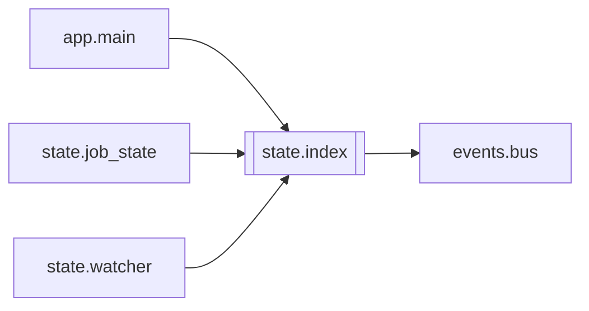

# `state.index`

[← Index](../generated/module-index.md) · [Brain home](../README.md)

<!-- AUTO:START — sinh bởi scripts/brain_build.py 2026-11-11 13:00. Đừng sửa tay khối này. -->
**File:** `state/index.py` · **Lớp:** `misc` · **106 dòng** (89 code) · **1 hàm**, **1 class** · sha1 `da86bee789`

> state/index.py — Danh sách job trong bộ nhớ (thay việc đọc lại mọi manifest mỗi 2 s). - `load_all(work_root)` 1 lần lúc start; sau đó chỉ `apply(job_id, data)` mỗi khi state.job_state ghi. - `GET /api/jobs` trả `index.li

### Phụ thuộc

- **Gọi tới (import nội bộ):** [events.bus](./events.bus.md)
- **Được dùng bởi:** [app.main](./app.main.md), [state.job_state](./state.job_state.md), [state.watcher](./state.watcher.md)
- **Test:** `tests/conftest.py`, `tests/test_f1_write_path.py`, `tests/test_f3_static.py`, `tests/test_f6_final_audit.py`, `tests/test_state_job_state.py`

### Hàm & class top-level

| Tên | Dòng | Dài | Tham số | Docstring |
|---|---:|---:|---|---|
| **class `JobIndex`** | 52 | 6 method | |  |
| `summarize` | 20 | 30 | `job_id, data` | Tóm tắt nhẹ cho danh sách (không stat file). Chi tiết lấy qua GET /api/jobs/{id}. |

**File/artifact nhắc tới:** `manifest.json`

### Lịch sử (từ docs/)

- **Fix logs (1):**
  - [2026-11-11 — F2 (core/job_opts) + F3 tích hợp (1 tiến trình V5+V6, UI cũ hết polling)](../../fixes/2026-11-11-f2-f3-integration.md)
- **Reviews:** [2026-11-11-review-f4-f5](../../reviews/2026-11-11-review-f4-f5.md), [2026-11-11-review-f2-f3](../../reviews/2026-11-11-review-f2-f3.md)
- Nhắc trong CHANGELOG: **0** lần · DECISIONS: **0** lần

<!-- AUTO:END -->

<!-- MANUAL:START -->
## Vai trò (viết tay)

_Chưa viết. 2–4 câu: module này chịu trách nhiệm gì trong pipeline, ai gọi nó, nó KHÔNG làm gì._

## Luồng chính

_Các hàm vào (entry) → bước chính → output/side effect. Ghi tên hàm thật._

## Bất biến & hợp đồng

_Điều luôn phải đúng (vd: chỉ ghi manifest qua `Manifest.update`; 1 job / ghế). Vi phạm = bug._

## Bẫy đã biết

_Lỗi từng gặp + link `docs/fixes/...`. Những chỗ dễ sửa sai._

## Ghi chú vận hành

_Config key quan trọng, cần restart gì khi sửa (:8801 / :8802 / hot-reload), cách test._
<!-- MANUAL:END -->
