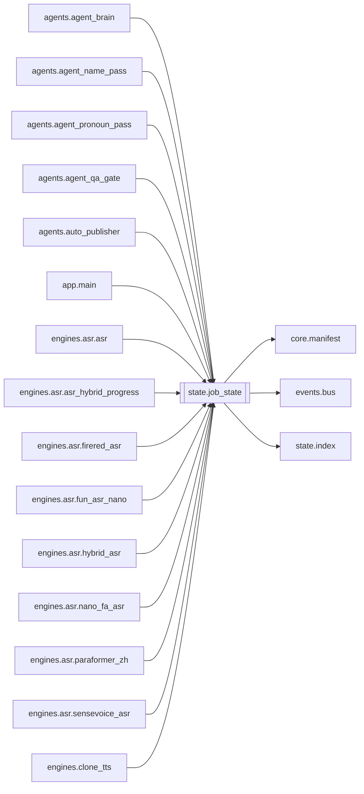

# `state.job_state`

[← Index](../generated/module-index.md) · [Brain home](../README.md)

<!-- AUTO:START — sinh bởi scripts/brain_build.py 2026-11-11 13:00. Đừng sửa tay khối này. -->
**File:** `state/job_state.py` · **Lớp:** `misc` · **269 dòng** (205 code) · **19 hàm**, **1 class** · sha1 `b47eeeab91`

> state/job_state.py — NGUỒN DUY NHẤT ghi trạng thái job (B9). Mọi chỗ trước đây `m = Manifest(wd); m.data[...] = ...; m.save()` chuyển sang các hàm dưới. Mỗi hàm = MỘT `Manifest.update(fn)`: đọc lại đĩa → sửa đúng khoá củ

### Phụ thuộc

- **Gọi tới (import nội bộ):** [core.manifest](./core.manifest.md), [events.bus](./events.bus.md), [state.index](./state.index.md)
- **Được dùng bởi:** [agents.agent_brain](./agents.agent_brain.md), [agents.agent_name_pass](./agents.agent_name_pass.md), [agents.agent_pronoun_pass](./agents.agent_pronoun_pass.md), [agents.agent_qa_gate](./agents.agent_qa_gate.md), [agents.auto_publisher](./agents.auto_publisher.md), [app.main](./app.main.md), [engines.asr.asr](./engines.asr.asr.md), [engines.asr.asr_hybrid_progress](./engines.asr.asr_hybrid_progress.md), [engines.asr.firered_asr](./engines.asr.firered_asr.md), [engines.asr.fun_asr_nano](./engines.asr.fun_asr_nano.md), [engines.asr.hybrid_asr](./engines.asr.hybrid_asr.md), [engines.asr.nano_fa_asr](./engines.asr.nano_fa_asr.md), [engines.asr.paraformer_zh](./engines.asr.paraformer_zh.md), [engines.asr.sensevoice_asr](./engines.asr.sensevoice_asr.md), [engines.clone_tts](./engines.clone_tts.md), [engines.download](./engines.download.md), [engines.ocr](./engines.ocr.md), [engines.pronoun_consistency](./engines.pronoun_consistency.md), [engines.render](./engines.render.md), [engines.render_job](./engines.render_job.md), [engines.separate](./engines.separate.md), [engines.split_parts](./engines.split_parts.md), [engines.translate](./engines.translate.md), [engines.translate_alts](./engines.translate_alts.md), [http_routes.routes_agent](./http_routes.routes_agent.md), [scripts.check_batch4](./scripts.check_batch4.md), [server](./server.md), [workers.render_worker](./workers.render_worker.md)
- **Test:** `tests/fake_render.py`, `tests/test_f1_write_path.py`, `tests/test_f5_render_job.py`, `tests/test_state_job_state.py`

### Hàm & class top-level

| Tên | Dòng | Dài | Tham số | Docstring |
|---|---:|---:|---|---|
| **class `StateError`** | 29 | 0 method | | Manifest hỏng / thiếu stages → không ghi (Manifest.update trả False). |
| `_index_hook` | 19 | 2 | `work_dir, data` |  |
| `_now` | 33 | 2 | `` |  |
| `_update` | 37 | 17 | `wd, fn` |  |
| `_stage` | 56 | 6 | `data, name` |  |
| `mark_running` | 66 | 10 | `wd, stage, cur_text, **extra` |  |
| `mark_done` | 78 | 9 | `wd, stage, **payload` |  |
| `mark_failed` | 89 | 8 | `wd, stage, error` |  |
| `set_stage` | 99 | 7 | `wd, stage, **fields` | Cập nhật vài khoá của 1 stage, KHÔNG đổi status trừ khi truyền status=… |
| `set_progress` | 108 | 8 | `wd, stage, publish, **fields` | Tiến độ (review_done, percent, cur_text…). Ghi đĩa + event `stage.progress` (bus tự throttle). |
| `reset_running` | 118 | 17 | `wd, note` | Lúc start server: stage còn 'running' là tàn dư → 'pending'. |
| `create_job` | 137 | 14 | `wd, request, **top` | Tạo manifest mới (job mới). Đã có thì không ghi đè. |
| `persist` | 155 | 8 | `m` | Ghi object Manifest mà code cũ đã sửa trực tiếp `m.data[...]`. |
| `set_hold` | 167 | 14 | `wd, reason, detail, block_tts, qa_blocked, stage_note` |  |
| `clear_hold` | 183 | 13 | `wd, reasons, override_qa` | Gỡ HOLD. `reasons`: chỉ gỡ nếu held_at thuộc tập này (None = gỡ mọi loại). |
| `set_review_retry` | 198 | 32 | `wd, n_unrev, retry_sec, max_tries` | B2: REVIEW còn câu chưa rv → park và hẹn chạy lại; quá max_tries → HOLD review_failed (cần người). |
| `park_ready` | 232 | 12 | `data, unrev, now` | Thuần (không I/O) — job park có chạy lại được chưa. |
| `mutate` | 246 | 4 | `wd, fn` | Đọc-sửa-ghi NGUYÊN TỬ cho logic riêng chưa có hàm ngữ nghĩa. fn(data) trả False = không ghi. |
| `set_queue_opts` | 254 | 9 | `wd, opts, merge` |  |
| `set_agent` | 265 | 5 | `wd, **fields` | Khoá khác trong manifest.agent (review_request, qa_gate, …). |

### Lịch sử (từ docs/)

- **Fix logs (1):**
  - [2026-11-11 — F1 (B9): mọi ghi manifest qua state/](../../fixes/2026-11-11-f1-b9-single-write-path.md)
- **Reviews:** [2026-11-11-review-f4-f5](../../reviews/2026-11-11-review-f4-f5.md)
- Nhắc trong CHANGELOG: **0** lần · DECISIONS: **0** lần

<!-- AUTO:END -->

<!-- MANUAL:START -->
## Vai trò (viết tay)

_Chưa viết. 2–4 câu: module này chịu trách nhiệm gì trong pipeline, ai gọi nó, nó KHÔNG làm gì._

## Luồng chính

_Các hàm vào (entry) → bước chính → output/side effect. Ghi tên hàm thật._

## Bất biến & hợp đồng

_Điều luôn phải đúng (vd: chỉ ghi manifest qua `Manifest.update`; 1 job / ghế). Vi phạm = bug._

## Bẫy đã biết

_Lỗi từng gặp + link `docs/fixes/...`. Những chỗ dễ sửa sai._

## Ghi chú vận hành

_Config key quan trọng, cần restart gì khi sửa (:8801 / :8802 / hot-reload), cách test._
<!-- MANUAL:END -->
