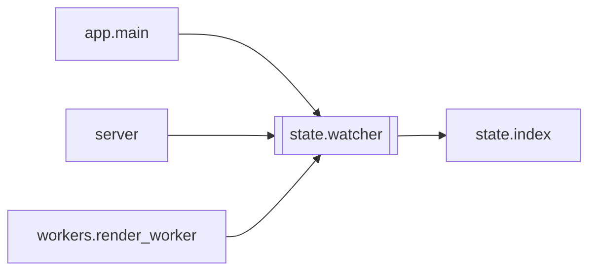

# `state.watcher`

[← Index](../generated/module-index.md) · [Brain home](../README.md)

<!-- AUTO:START — sinh bởi scripts/brain_build.py 2026-11-11 13:00. Đừng sửa tay khối này. -->
**File:** `state/watcher.py` · **Lớp:** `misc` · **145 dòng** (117 code) · **4 hàm**, **1 class** · sha1 `4f0f8eccb6`

> state/watcher.py — Bắt các lần ghi manifest từ TIẾN TRÌNH CON (asr/tts/render worker). Hook trong core.manifest chỉ chạy ở tiến trình nào ghi. Engine chạy subprocess ghi tiến độ thẳng vào manifest.json → server không biế

### Phụ thuộc

- **Gọi tới (import nội bộ):** [state.index](./state.index.md)
- **Được dùng bởi:** [app.main](./app.main.md), [server](./server.md), [workers.render_worker](./workers.render_worker.md)
- **Test:** `tests/test_f1_write_path.py`, `tests/test_f6_final_audit.py`

### Hàm & class top-level

| Tên | Dòng | Dài | Tham số | Docstring |
|---|---:|---:|---|---|
| **class `ManifestWatcher`** | 26 | 8 method | |  |
| `active_watchers` | 114 | 3 | `` |  |
| `watch_job` | 119 | 6 | `job_id` | Theo dõi job ở mọi watcher đang chạy (không có watcher → không làm gì). Trả số watcher. |
| `unwatch_job` | 127 | 9 | `job_id, final_check` | Bỏ theo dõi; trước đó đọc lần cuối (ghi cuối của tiến trình con — done/failed — lên index ngay). |
| `watching` | 139 | 7 | `job_id` | `with watching(jid): spawn tiến trình con…` — tiến độ con ghi manifest lên UI trong ~interval s. |

**File/artifact nhắc tới:** `manifest.json`

**Tín hiệu rủi ro (đếm tĩnh):** broad_except=2 · swallow_except=1 · threads=1

### Lịch sử (từ docs/)

- **Fix logs (1):**
  - [2026-11-11 — F1 (B9): mọi ghi manifest qua state/](../../fixes/2026-11-11-f1-b9-single-write-path.md)
- Nhắc trong CHANGELOG: **0** lần · DECISIONS: **0** lần

<!-- AUTO:END -->

<!-- MANUAL:START -->
## Vai trò (viết tay)

_Chưa viết. 2–4 câu: module này chịu trách nhiệm gì trong pipeline, ai gọi nó, nó KHÔNG làm gì._

## Luồng chính

_Các hàm vào (entry) → bước chính → output/side effect. Ghi tên hàm thật._

## Bất biến & hợp đồng

_Điều luôn phải đúng (vd: chỉ ghi manifest qua `Manifest.update`; 1 job / ghế). Vi phạm = bug._

## Bẫy đã biết

_Lỗi từng gặp + link `docs/fixes/...`. Những chỗ dễ sửa sai._

## Ghi chú vận hành

_Config key quan trọng, cần restart gì khi sửa (:8801 / :8802 / hot-reload), cách test._
<!-- MANUAL:END -->
