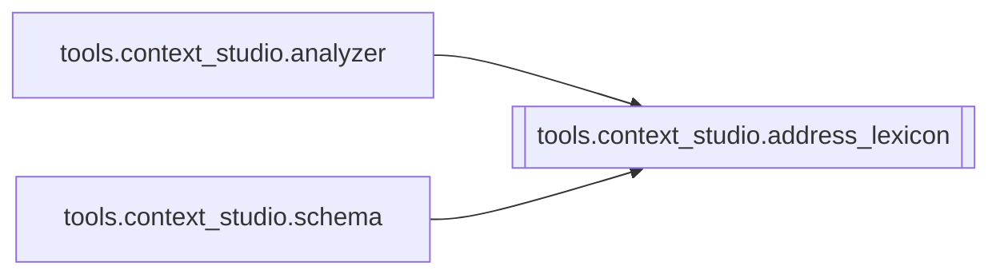

# `tools.context_studio.address_lexicon`

[← Index](../generated/module-index.md) · [Brain home](../README.md)

<!-- AUTO:START — sinh bởi scripts/brain_build.py 2026-11-11 13:00. Đừng sửa tay khối này. -->
**File:** `tools/context_studio/address_lexicon.py` · **Lớp:** `misc` · **338 dòng** (285 code) · **4 hàm**, **0 class** · sha1 `86623d3037`

> Kho xưng hô cổ trang / võ hiệp / tu tiên (VN dịch Trung). Nguồn tham chiếu (quy ước văn học–phim, không phải sử liệu tuyệt đối): - https://vandamphongkhuynh.com/2024/04/02/cach-xung-ho-trong-truyen-co-dai/

### Phụ thuộc

- **Gọi tới (import nội bộ):** —
- **Được dùng bởi:** [tools.context_studio.analyzer](./tools.context_studio.analyzer.md), [tools.context_studio.schema](./tools.context_studio.schema.md)
- **Test:** ❌ chưa có test import trực tiếp

### Hàm & class top-level

| Tên | Dòng | Dài | Tham số | Docstring |
|---|---:|---:|---|---|
| `address_bank` | 195 | 17 | `` | Nhóm theo ngữ dụng — đưa vào style_lock.address_bank. |
| `style_lock_policy` | 235 | 28 | `mode` |  |
| `merge_unique` | 265 | 10 | `base, extra` |  |
| `enrich_style_lock` | 277 | 62 | `lock, mode` | Đổ lexicon đầy đủ vào style_lock; modern thì tẩy địa chỉ cổ khỏi prefer. |

### Lịch sử (từ docs/)

- Fix logs: —
- Nhắc trong CHANGELOG: **0** lần · DECISIONS: **0** lần

<!-- AUTO:END -->

<!-- MANUAL:START -->
## Vai trò (viết tay)

_Chưa viết. 2–4 câu: module này chịu trách nhiệm gì trong pipeline, ai gọi nó, nó KHÔNG làm gì._

## Luồng chính

_Các hàm vào (entry) → bước chính → output/side effect. Ghi tên hàm thật._

## Bất biến & hợp đồng

_Điều luôn phải đúng (vd: chỉ ghi manifest qua `Manifest.update`; 1 job / ghế). Vi phạm = bug._

## Bẫy đã biết

_Lỗi từng gặp + link `docs/fixes/...`. Những chỗ dễ sửa sai._

## Ghi chú vận hành

_Config key quan trọng, cần restart gì khi sửa (:8801 / :8802 / hot-reload), cách test._
<!-- MANUAL:END -->
