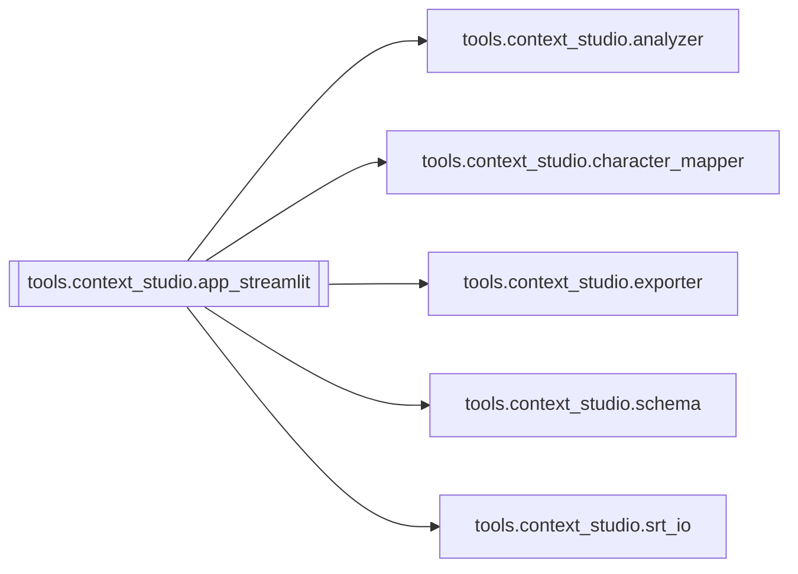

# `tools.context_studio.app_streamlit`

[← Index](../generated/module-index.md) · [Brain home](../README.md)

<!-- AUTO:START — sinh bởi scripts/brain_build.py 2026-11-11 13:00. Đừng sửa tay khối này. -->
**File:** `tools/context_studio/app_streamlit.py` · **Lớp:** `control` · **108 dòng** (95 code) · **0 hàm**, **0 class** · sha1 `edfdc968b0`

> Streamlit UI stub — Context Detection trước khi dịch Pineline. Chạy: pip install streamlit

### Phụ thuộc

- **Gọi tới (import nội bộ):** [tools.context_studio.analyzer](./tools.context_studio.analyzer.md), [tools.context_studio.character_mapper](./tools.context_studio.character_mapper.md), [tools.context_studio.exporter](./tools.context_studio.exporter.md), [tools.context_studio.schema](./tools.context_studio.schema.md), [tools.context_studio.srt_io](./tools.context_studio.srt_io.md)
- **Được dùng bởi:** —
- **Test:** ❌ chưa có test import trực tiếp
- **Thư viện ngoài:** `streamlit`

**File/artifact nhắc tới:** `glossary.json`

### Lịch sử (từ docs/)

- Fix logs: —
- Nhắc trong CHANGELOG: **0** lần · DECISIONS: **0** lần

<!-- AUTO:END -->

<!-- MANUAL:START -->
## Vai trò (viết tay)

_Chưa viết. 2–4 câu: module này chịu trách nhiệm gì trong pipeline, ai gọi nó, nó KHÔNG làm gì._

## Luồng chính

_Các hàm vào (entry) → bước chính → output/side effect. Ghi tên hàm thật._

## Bất biến & hợp đồng

_Điều luôn phải đúng (vd: chỉ ghi manifest qua `Manifest.update`; 1 job / ghế). Vi phạm = bug._

## Bẫy đã biết

_Lỗi từng gặp + link `docs/fixes/...`. Những chỗ dễ sửa sai._

## Ghi chú vận hành

_Config key quan trọng, cần restart gì khi sửa (:8801 / :8802 / hot-reload), cách test._
<!-- MANUAL:END -->
