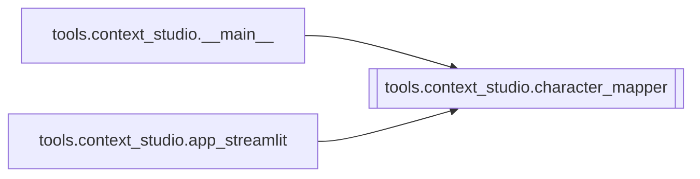

# `tools.context_studio.character_mapper`

[← Index](../generated/module-index.md) · [Brain home](../README.md)

<!-- AUTO:START — sinh bởi scripts/brain_build.py 2026-11-11 13:00. Đừng sửa tay khối này. -->
**File:** `tools/context_studio/character_mapper.py` · **Lớp:** `misc` · **353 dòng** (303 code) · **10 hàm**, **0 class** · sha1 `a428f26b8e`

> 02 — Character + relation map: ai tự xưng gì khi nói với ai.

### Phụ thuộc

- **Gọi tới (import nội bộ):** —
- **Được dùng bởi:** [tools.context_studio.__main__](./tools.context_studio.__main__.md), [tools.context_studio.app_streamlit](./tools.context_studio.app_streamlit.md)
- **Test:** ❌ chưa có test import trực tiếp

### Hàm & class top-level

| Tên | Dòng | Dài | Tham số | Docstring |
|---|---:|---:|---|---|
| `_lock_mode` | 27 | 11 | `glossary` |  |
| `_plausible_name` | 43 | 3 | `name, blob` | «弟子三轮全力一击» → «三轮全力» không phải tên: loại số/hư từ, cần xuất hiện ≥2 lần. |
| `_char_key` | 48 | 2 | `c` |  |
| `_ensure_char` | 52 | 32 | `chars, zh, vi, role, gender, status, self_ref` |  |
| `infer_roles_from_segments` | 86 | 62 | `glossary, segments` | Bổ sung nhân vật/role từ từ khóa thoại (heuristic, không diarization). |
| `build_relation_pronouns` | 150 | 25 | `glossary` | Chuẩn hóa pronouns[] + relation_matrix — CHỈ cặp có bằng chứng (từ LLM/tay). |
| `_matrix_from_pronouns` | 177 | 13 | `pronouns` | Dạng phẳng tiện UI: who / to / self / call. |
| `sanitize_pronouns` | 192 | 45 | `glossary` | Tách pronouns.to kiểu 'A, B, C' → nhiều rule; modern: tẩy self/call cổ. |
| `enrich_characters` | 239 | 90 | `glossary, segments` | Chuẩn hóa characters + suy role + sinh pronouns quan hệ. |
| `validate_pronouns` | 331 | 23 | `glossary` | Cảnh báo who/to không khớp tên trong characters (vi hoặc zh). |

### Lịch sử (từ docs/)

- Fix logs: —
- Nhắc trong CHANGELOG: **0** lần · DECISIONS: **0** lần

<!-- AUTO:END -->

<!-- MANUAL:START -->
## Vai trò (viết tay)

_Chưa viết. 2–4 câu: module này chịu trách nhiệm gì trong pipeline, ai gọi nó, nó KHÔNG làm gì._

## Luồng chính

_Các hàm vào (entry) → bước chính → output/side effect. Ghi tên hàm thật._

## Bất biến & hợp đồng

_Điều luôn phải đúng (vd: chỉ ghi manifest qua `Manifest.update`; 1 job / ghế). Vi phạm = bug._

## Bẫy đã biết

_Lỗi từng gặp + link `docs/fixes/...`. Những chỗ dễ sửa sai._

## Ghi chú vận hành

_Config key quan trọng, cần restart gì khi sửa (:8801 / :8802 / hot-reload), cách test._
<!-- MANUAL:END -->
