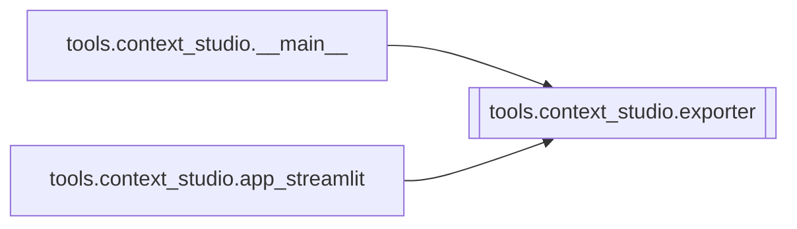

# `tools.context_studio.exporter`

[← Index](../generated/module-index.md) · [Brain home](../README.md)

<!-- AUTO:START — sinh bởi scripts/brain_build.py 2026-11-11 13:00. Đừng sửa tay khối này. -->
**File:** `tools/context_studio/exporter.py` · **Lớp:** `misc` · **73 dòng** (62 code) · **1 hàm**, **0 class** · sha1 `7692ad940f`

> 05 — Export context pack vào thư mục job Pineline (hoặc out/).

### Phụ thuộc

- **Gọi tới (import nội bộ):** —
- **Được dùng bởi:** [tools.context_studio.__main__](./tools.context_studio.__main__.md), [tools.context_studio.app_streamlit](./tools.context_studio.app_streamlit.md)
- **Test:** ❌ chưa có test import trực tiếp

### Hàm & class top-level

| Tên | Dòng | Dài | Tham số | Docstring |
|---|---:|---:|---|---|
| `write_pack` | 9 | 65 | `out_dir, glossary, flags, also_style_lock_file` | Ghi: |

**File/artifact nhắc tới:** `context_pack.json`, `glossary.json`, `qa_flags.json`, `relation_matrix.json`, `style_lock.json`

**Tín hiệu rủi ro (đếm tĩnh):** file_writes=5

### Lịch sử (từ docs/)

- Fix logs: —
- Nhắc trong CHANGELOG: **0** lần · DECISIONS: **0** lần

<!-- AUTO:END -->

<!-- MANUAL:START -->
## Vai trò (viết tay)

_Chưa viết. 2–4 câu: module này chịu trách nhiệm gì trong pipeline, ai gọi nó, nó KHÔNG làm gì._

## Luồng chính

_Các hàm vào (entry) → bước chính → output/side effect. Ghi tên hàm thật._

## Bất biến & hợp đồng

_Điều luôn phải đúng (vd: chỉ ghi manifest qua `Manifest.update`; 1 job / ghế). Vi phạm = bug._

## Bẫy đã biết

_Lỗi từng gặp + link `docs/fixes/...`. Những chỗ dễ sửa sai._

## Ghi chú vận hành

_Config key quan trọng, cần restart gì khi sửa (:8801 / :8802 / hot-reload), cách test._
<!-- MANUAL:END -->
