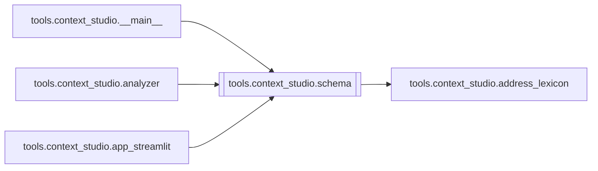

# `tools.context_studio.schema`

[← Index](../generated/module-index.md) · [Brain home](../README.md)

<!-- AUTO:START — sinh bởi scripts/brain_build.py 2026-11-11 13:00. Đừng sửa tay khối này. -->
**File:** `tools/context_studio/schema.py` · **Lớp:** `misc` · **129 dòng** (113 code) · **3 hàm**, **0 class** · sha1 `e077d40fad`

> Heuristic number / name flags — không sửa transcript.

### Phụ thuộc

- **Gọi tới (import nội bộ):** [tools.context_studio.address_lexicon](./tools.context_studio.address_lexicon.md)
- **Được dùng bởi:** [tools.context_studio.__main__](./tools.context_studio.__main__.md), [tools.context_studio.analyzer](./tools.context_studio.analyzer.md), [tools.context_studio.app_streamlit](./tools.context_studio.app_streamlit.md)
- **Test:** ❌ chưa có test import trực tiếp

### Hàm & class top-level

| Tên | Dòng | Dài | Tham số | Docstring |
|---|---:|---:|---|---|
| `scan_number_flags` | 14 | 35 | `segments, window` | Cờ số đáng ngờ: dòng có 万/亿/兆 hoặc cụm số lạ so với lân cận có 亿. |
| `empty_glossary_skeleton` | 51 | 25 | `` | Schema khớp Pineline translate.build_plan (+ style_lock). |
| `apply_style_lock_from_genre` | 78 | 52 | `glossary` | Suy style_lock từ genre/tone + đổ lexicon đầy đủ (address_lexicon). |

### Lịch sử (từ docs/)

- Fix logs: —
- Nhắc trong CHANGELOG: **0** lần · DECISIONS: **0** lần

<!-- AUTO:END -->

<!-- MANUAL:START -->
## Vai trò (viết tay)

_Chưa viết. 2–4 câu: module này chịu trách nhiệm gì trong pipeline, ai gọi nó, nó KHÔNG làm gì._

## Luồng chính

_Các hàm vào (entry) → bước chính → output/side effect. Ghi tên hàm thật._

## Bất biến & hợp đồng

_Điều luôn phải đúng (vd: chỉ ghi manifest qua `Manifest.update`; 1 job / ghế). Vi phạm = bug._

## Bẫy đã biết

_Lỗi từng gặp + link `docs/fixes/...`. Những chỗ dễ sửa sai._

## Ghi chú vận hành

_Config key quan trọng, cần restart gì khi sửa (:8801 / :8802 / hot-reload), cách test._
<!-- MANUAL:END -->
