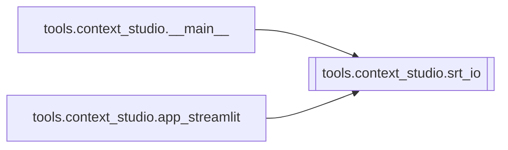

# `tools.context_studio.srt_io`

[← Index](../generated/module-index.md) · [Brain home](../README.md)

<!-- AUTO:START — sinh bởi scripts/brain_build.py 2026-11-11 13:00. Đừng sửa tay khối này. -->
**File:** `tools/context_studio/srt_io.py` · **Lớp:** `misc` · **99 dòng** (86 code) · **4 hàm**, **0 class** · sha1 `f94e74fccb`

> Parse SRT / asr.json → list[{i, start, end, text}].

### Phụ thuộc

- **Gọi tới (import nội bộ):** —
- **Được dùng bởi:** [tools.context_studio.__main__](./tools.context_studio.__main__.md), [tools.context_studio.app_streamlit](./tools.context_studio.app_streamlit.md)
- **Test:** ❌ chưa có test import trực tiếp

### Hàm & class top-level

| Tên | Dòng | Dài | Tham số | Docstring |
|---|---:|---:|---|---|
| `_ts_to_sec` | 14 | 3 | `h, m, s, ms` |  |
| `parse_srt` | 19 | 36 | `path` | Đọc file .srt → segments Pineline-compatible. |
| `parse_asr_json` | 57 | 19 | `path` | Đọc asr.json Pineline → segments. |
| `load_segments` | 78 | 22 | `path` | Tự nhận .srt / asr.json / script.json (lấy zh). |

### Lịch sử (từ docs/)

- Fix logs: —
- Nhắc trong CHANGELOG: **0** lần · DECISIONS: **0** lần

<!-- AUTO:END -->

<!-- MANUAL:START -->
## Vai trò (viết tay)

_Chưa viết. 2–4 câu: module này chịu trách nhiệm gì trong pipeline, ai gọi nó, nó KHÔNG làm gì._

## Luồng chính

_Các hàm vào (entry) → bước chính → output/side effect. Ghi tên hàm thật._

## Bất biến & hợp đồng

_Điều luôn phải đúng (vd: chỉ ghi manifest qua `Manifest.update`; 1 job / ghế). Vi phạm = bug._

## Bẫy đã biết

_Lỗi từng gặp + link `docs/fixes/...`. Những chỗ dễ sửa sai._

## Ghi chú vận hành

_Config key quan trọng, cần restart gì khi sửa (:8801 / :8802 / hot-reload), cách test._
<!-- MANUAL:END -->
