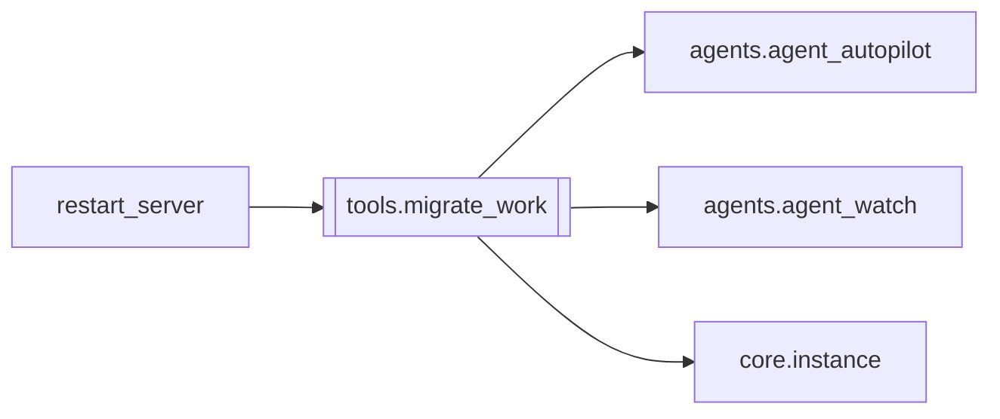

# `tools.migrate_work`

[← Index](../generated/module-index.md) · [Brain home](../README.md)

<!-- AUTO:START — sinh bởi scripts/brain_build.py 2026-11-11 13:00. Đừng sửa tay khối này. -->
**File:** `tools/migrate_work.py` · **Lớp:** `ops` · **396 dòng** (328 code) · **20 hàm**, **0 class** · sha1 `b8bb0d4fb4`

> Chuyển Z:\PinelineV2\work sang ổ khác (mặc định D:\PinelineV2_work) giữa 2 job, không mất tiến độ. 1. Copy trước (robocopy /MIR) trong lúc job hiện tại vẫn chạy. 2. Rút các job đang chờ khỏi hàng + tắt Auto-pilot → worke

### Phụ thuộc

- **Gọi tới (import nội bộ):** [agents.agent_autopilot](./agents.agent_autopilot.md), [agents.agent_watch](./agents.agent_watch.md), [core.instance](./core.instance.md)
- **Được dùng bởi:** [restart_server](./restart_server.md)
- **Test:** `tests/test_review2_f4f5.py`, `tests/v5/test_restart_guard.py`
- **Thư viện ngoài:** `psutil`, `requests`

### Hàm & class top-level

| Tên | Dòng | Dài | Tham số | Docstring |
|---|---:|---:|---|---|
| `log` | 46 | 11 | `msg` |  |
| `_instance` | 59 | 3 | `` |  |
| `telegram_allowed` | 64 | 10 | `` | review2: script ops chỉ gửi Telegram khi instance bật telegram (v6/test: KHÔNG). Trước đây |
| `tg` | 76 | 10 | `msg` |  |
| `robocopy` | 88 | 12 | `label` |  |
| `api` | 102 | 6 | `method, url, body, timeout` |  |
| `api_retry` | 110 | 11 | `method, url, body, timeout, tries` | Server đang render nặng có thể trễ >30s — không coi 1 lần timeout là lỗi chết. |
| `running_stages` | 123 | 17 | `root` |  |
| `procs` | 142 | 7 | `pattern` |  |
| `_norm` | 151 | 2 | `path` |  |
| `same_root` | 155 | 18 | `p, root` | review2: tiến trình có thuộc CÂY này không (cwd = ROOT, hoặc cmdline chứa đường ROOT). |
| `instance_procs` | 175 | 17 | `pattern, instance` | procs(pattern) nhưng CHỈ của cây này; `instance` → bỏ tiến trình chạy `--instance` khác. |
| `server_procs` | 194 | 14 | `port, instance` | Backend của instance (`-m app --instance X` / `server.py --port N`) — so token + cùng cây. |
| `start_backend` | 210 | 5 | `name, env` | Khởi động backend của instance (thay run_v2.bat/run_v5.bat — không có trong cây V6). |
| `start_sidecar` | 217 | 4 | `name, env` |  |
| `kill_with_parent_cmd` | 223 | 31 | `p` |  |
| `start_bat` | 256 | 5 | `name` |  |
| `wait_http` | 263 | 9 | `url, sec` |  |
| `start_services_and_requeue` | 274 | 20 | `pending, opts, ap_was` |  |
| `main` | 296 | 90 | `` |  |

### Config / env keys (4)

`AGENT_TELEGRAM`, `PINELINE_FLAG_TELEGRAM`, `PINELINE_INSTANCE`, `WORK_DIR`

**File/artifact nhắc tới:** `manifest.json`, `migrate_work.log`, `migrate_work.prev.log`, `migrate_work_plan.json`

**Tín hiệu rủi ro (đếm tĩnh):** broad_except=14 · file_writes=1 · sleep=5 · subprocess=5 · swallow_except=3

### Lịch sử (từ docs/)

- **Fix logs (1):**
  - [2026-11-11 — F4 (services + sidecar thuần) + F5 (render tiến trình con)](../../fixes/2026-11-11-f4-f5.md)
- **Reviews:** [2026-11-11-review-f4-f5](../../reviews/2026-11-11-review-f4-f5.md)
- Nhắc trong CHANGELOG: **0** lần · DECISIONS: **0** lần

<!-- AUTO:END -->

<!-- MANUAL:START -->
## Vai trò (viết tay)

_Chưa viết. 2–4 câu: module này chịu trách nhiệm gì trong pipeline, ai gọi nó, nó KHÔNG làm gì._

## Luồng chính

_Các hàm vào (entry) → bước chính → output/side effect. Ghi tên hàm thật._

## Bất biến & hợp đồng

_Điều luôn phải đúng (vd: chỉ ghi manifest qua `Manifest.update`; 1 job / ghế). Vi phạm = bug._

## Bẫy đã biết

_Lỗi từng gặp + link `docs/fixes/...`. Những chỗ dễ sửa sai._

## Ghi chú vận hành

_Config key quan trọng, cần restart gì khi sửa (:8801 / :8802 / hot-reload), cách test._
<!-- MANUAL:END -->
