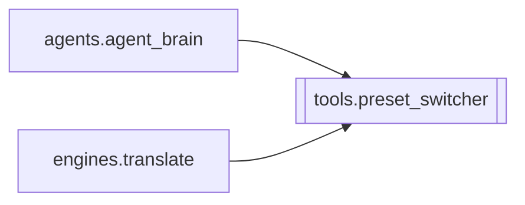

# `tools.preset_switcher`

[← Index](../generated/module-index.md) · [Brain home](../README.md)

<!-- AUTO:START — sinh bởi scripts/brain_build.py 2026-11-11 13:00. Đừng sửa tay khối này. -->
**File:** `tools/preset_switcher.py` · **Lớp:** `ops` · **225 dòng** (178 code) · **5 hàm**, **0 class** · sha1 `a4c0e305fa`

> preset_switcher.py — Tự động chuyển đổi Preset Model trên llama-server (:8083) Quản lý bộ presets tại E:\models\presets (chạy script start-model.ps1). Chức năng:

### Phụ thuộc

- **Gọi tới (import nội bộ):** —
- **Được dùng bởi:** [agents.agent_brain](./agents.agent_brain.md), [engines.translate](./engines.translate.md)
- **Được nhắc tên file `.py` (subprocess/script) bởi:** [restart_server](./restart_server.md)
- **Test:** ❌ chưa có test import trực tiếp
- **Thư viện ngoài:** `requests`

### Hàm & class top-level

| Tên | Dòng | Dài | Tham số | Docstring |
|---|---:|---:|---|---|
| `get_active_preset` | 31 | 23 | `` | Trả về ID hoặc alias của model đang thực sự hoạt động trên llama-server (:8083). |
| `list_available_presets` | 56 | 18 | `` | Trả về danh sách tất cả các preset có trong models.json. |
| `is_model_ready` | 76 | 48 | `target_preset, ping_inference` | Kiểm tra toàn diện xem llama-server :8083 đã khởi động xong và sẵn sàng nhận prompt chưa. |
| `switch_preset` | 130 | 9 | `preset_id, max_wait_sec` | Bản có khoá của _switch_preset_unlocked (xem docstring bên dưới). |
| `_switch_preset_unlocked` | 141 | 85 | `preset_id, max_wait_sec` | Chuyển đổi llama-server sang preset mong muốn và CHỜ ĐỢI cho đến khi AI mở lại hoàn toàn. |

### Config / env keys (1)

`MODEL_PRESETS_DIR`

**File/artifact nhắc tới:** `active.json`, `models.json`

**Tín hiệu rủi ro (đếm tĩnh):** broad_except=7 · sleep=2 · subprocess=1 · swallow_except=2

### Lịch sử (từ docs/)

- Fix logs: —
- Nhắc trong CHANGELOG: **0** lần · DECISIONS: **0** lần

<!-- AUTO:END -->

<!-- MANUAL:START -->
## Vai trò (viết tay)

_Chưa viết. 2–4 câu: module này chịu trách nhiệm gì trong pipeline, ai gọi nó, nó KHÔNG làm gì._

## Luồng chính

_Các hàm vào (entry) → bước chính → output/side effect. Ghi tên hàm thật._

## Bất biến & hợp đồng

_Điều luôn phải đúng (vd: chỉ ghi manifest qua `Manifest.update`; 1 job / ghế). Vi phạm = bug._

## Bẫy đã biết

_Lỗi từng gặp + link `docs/fixes/...`. Những chỗ dễ sửa sai._

## Ghi chú vận hành

_Config key quan trọng, cần restart gì khi sửa (:8801 / :8802 / hot-reload), cách test._
<!-- MANUAL:END -->
