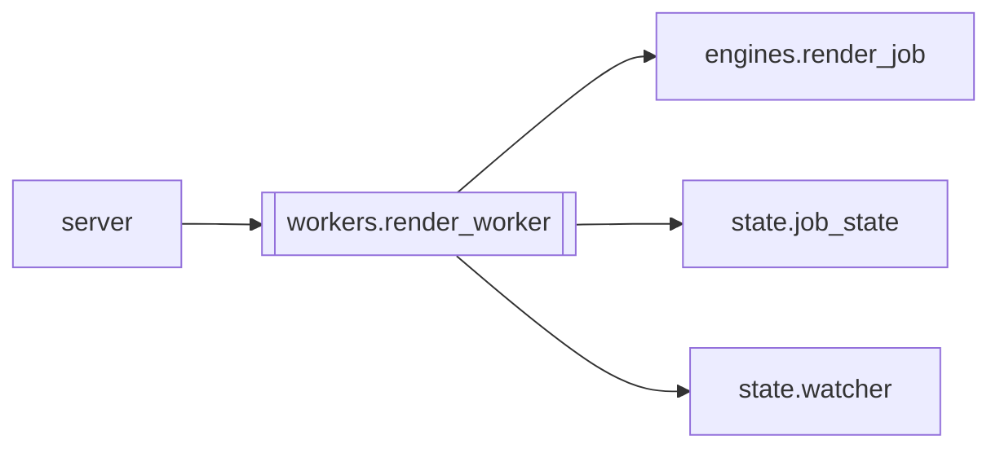

# `workers.render_worker`

[← Index](../generated/module-index.md) · [Brain home](../README.md)

<!-- AUTO:START — sinh bởi scripts/brain_build.py 2026-11-11 13:00. Đừng sửa tay khối này. -->
**File:** `workers/render_worker.py` · **Lớp:** `render` · **300 dòng** (261 code) · **8 hàm**, **1 class** · sha1 `161422938b`

> workers/render_worker.py — Render/mux chạy TIẾN TRÌNH CON (quyết định 11-11: render subprocess). Vì sao: V5 render trong tiến trình server và `importlib.reload` core.config/engines.subs/render/assemble mỗi lần mux để sửa

### Phụ thuộc

- **Gọi tới (import nội bộ):** [engines.render_job](./engines.render_job.md), [state.job_state](./state.job_state.md), [state.watcher](./state.watcher.md)
- **Được dùng bởi:** [server](./server.md)
- **Được nhắc tên file `.py` (subprocess/script) bởi:** [engines.render_job](./engines.render_job.md), [server](./server.md)
- **Test:** `tests/fake_render.py`, `tests/test_f5_render_subprocess.py`, `tests/test_f6_final_audit.py`, `tests/test_render_worker.py`, `tests/test_review2_f4f5.py`
- **Thư viện ngoài:** `psutil`, `state`

### Hàm & class top-level

| Tên | Dòng | Dài | Tham số | Docstring |
|---|---:|---:|---|---|
| **class `RenderStopped`** | 194 | 0 method | | Người dùng bấm Dừng trong lúc worker chạy (server đổi thành _Stopped). |
| `emit` | 37 | 2 | `ev, **kw` |  |
| `parse_lines` | 41 | 14 | `lines, on_line` | Chỉ lấy JSON có 'ev'; dòng log thường (ffmpeg, print) → on_line (nếu có). |
| `child_env` | 57 | 10 | `base` | Env cho tiến trình con: root trên PYTHONPATH, stdout UTF-8, bỏ PYTHONHASHSEED hỏng (như _run_engine). |
| `kill_tree` | 69 | 59 | `proc, grace` | Kill tiến trình + MỌI hậu duệ (review2). |
| `spawn` | 130 | 62 | `work_dir, opts, python, on_event, is_stopped, module, env, on_start…` | Phía server: chạy worker, chuyển sự kiện cho on_event; trả sự kiện cuối (done/error). |
| `run_job` | 198 | 58 | `work_dir, kw, procs, is_stopped, on_line, python, env, **spawn_kw` | Phía server (không cần fastapi → test được): chạy 1 lần render ở tiến trình con. |
| `_impl` | 258 | 9 | `` | Hàm render: mặc định engines.render_job.do_render; test đặt PINELINE_RENDER_IMPL=module:func. |
| `main` | 269 | 28 | `argv` |  |

### Config / env keys (1)

`PINELINE_RENDER_IMPL`

**File/artifact nhắc tới:** `output.mp4`

**Tín hiệu rủi ro (đếm tĩnh):** broad_except=13 · subprocess=2 · swallow_except=8 · threads=1

### Lịch sử (từ docs/)

- **Fix logs (1):**
  - [2026-11-11 — F4 (services + sidecar thuần) + F5 (render tiến trình con)](../../fixes/2026-11-11-f4-f5.md)
- **Reviews:** [2026-11-11-review-f4-f5](../../reviews/2026-11-11-review-f4-f5.md)
- Nhắc trong CHANGELOG: **1** lần · DECISIONS: **0** lần

<!-- AUTO:END -->

<!-- MANUAL:START -->
## Vai trò (viết tay)

_Chưa viết. 2–4 câu: module này chịu trách nhiệm gì trong pipeline, ai gọi nó, nó KHÔNG làm gì._

## Luồng chính

_Các hàm vào (entry) → bước chính → output/side effect. Ghi tên hàm thật._

## Bất biến & hợp đồng

_Điều luôn phải đúng (vd: chỉ ghi manifest qua `Manifest.update`; 1 job / ghế). Vi phạm = bug._

## Bẫy đã biết

_Lỗi từng gặp + link `docs/fixes/...`. Những chỗ dễ sửa sai._

## Ghi chú vận hành

_Config key quan trọng, cần restart gì khi sửa (:8801 / :8802 / hot-reload), cách test._
<!-- MANUAL:END -->
