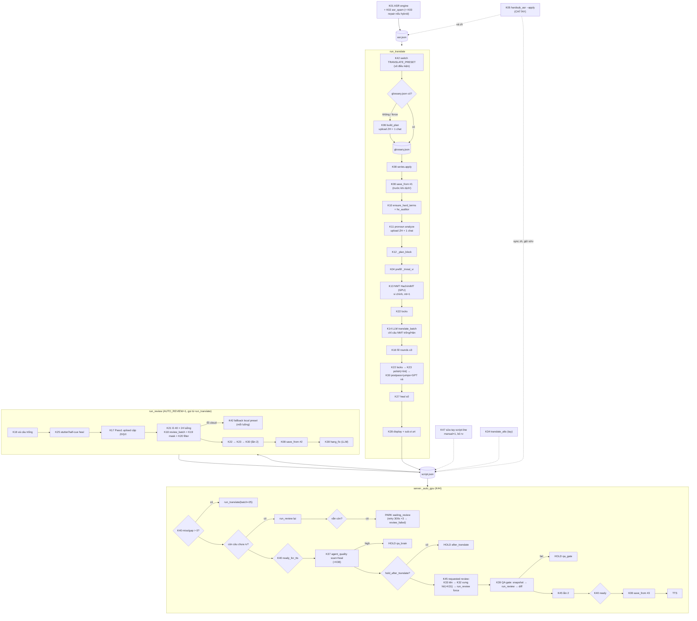
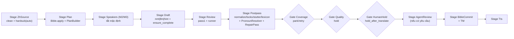

# Review KIẾN TRÚC hệ thống dịch ZH→VI — bản đồ, tương quan, quyết định

_2026-11-11 · chỉ đọc, không sửa code · bổ sung cho `docs/design/2026-11-11-translation-quality.md` (M0–M8) và `docs/reviews/2026-11-11-translate-review.md` (C*/T*/L*). Bài này **không** lặp lại danh sách bug; khi cần, chỉ dẫn mã C*/T*._

## Mục lục

0. [Phạm vi, nguồn, mức tin cậy](#0-phạm-vi-nguồn-mức-tin-cậy)
1. [Tóm tắt điều hành](#1-tóm-tắt-điều-hành)
2. [Bản đồ thành phần (V2 production, đối chiếu V6)](#2-bản-đồ-thành-phần)
3. [Luồng dữ liệu thực tế](#3-luồng-dữ-liệu-thực-tế)
4. [Ma trận tương quan thành phần × vấn đề](#4-ma-trận-tương-quan)
5. [Quyết định từng thành phần](#5-quyết-định-từng-thành-phần)
6. [Kiến trúc đích](#6-kiến-trúc-đích)
7. [Lộ trình di chuyển (strangler)](#7-lộ-trình-di-chuyển-strangler)
8. [Cấu hình](#8-cấu-hình)
9. [Rủi ro & câu hỏi cho chủ dự án](#9-rủi-ro--câu-hỏi-cho-chủ-dự-án)

---

## 0. Phạm vi, nguồn, mức tin cậy

- **Nguồn đọc (V2 = production, layout phẳng):** stage từ `Z:\PinelineV2` lúc ~11-11 (mtime `translate.py` = 1794340627334): `translate.py` (4125 dòng), `llm.py`, `mt_zh_vi.py`, `pronoun_consistency.py`, `pronoun_register_policy.py`, `agent_pronoun_pass.py`, `agent_name_pass.py`, `agent_quality.py`, `agent_qa_gate.py`, `script_lint.py`, `hv_auditor.py`, `series_glossary.py`, `translate_alts.py`, `asr_spam.py`, `asr_repair.py`, `hardsub_asr.py`, `preset_switcher.py`, `config.py`, `context_studio/*`, `server.py` (đoạn `_auto_gpu` 1708–1965, `_run_requested_review` 1631–1690, endpoint `script-line` 4071–4135). Giá trị config production đọc từ `pineline.config.json` (chỉ key không bí mật).
- **Đối chiếu V6:** diff đã chuẩn hoá import + CRLF trên VM: `engines/translate.py` của V6 **chỉ khác V2 ở import (`engines.*`, `tools.preset_switcher`) và `m.save()`→`js.persist(m)`**; `agents/agent_pronoun_pass.py`, `agents/agent_qa_gate.py` tương tự; `engines/llm.py` + `tools/preset_switcher.py` có thêm `core.machine` (cổng/thư mục theo máy). Logic dịch V6 ≡ V2. `pipeline/stages/` và `pipeline/gates/` của V6 **còn rỗng** (chỉ `pipeline/base.py`); V6 vẫn dịch qua `server._auto_gpu` legacy. V6 **không có** `data/unihan/`, `data/series_glossary/` (V2 có 78 file kho bộ) và `context_studio` nằm ở `tools/` (→ C6, T17).
- **Lưu ý đồng thời:** một agent khác đang sửa đợt 1 (C1, C2, C3, C9, T18) trên V2. Bản tôi đọc có thể đã có một phần (vd docstring `_review_chunk_with_fallback` đã nói "None nghĩa là LÔ LỖI"). Kết luận kiến trúc không phụ thuộc trạng thái các bản vá đó.
- **Không chạy** LLM/GPU/HTTP. Quy ước: điều đọc thấy trong code → khẳng định; suy luận → **(cần xác minh)**.

---

## 1. Tóm tắt điều hành

**Hình dạng thật của hệ thống:** _NMT câu-đơn (HachimiMT, GPU) viết bản chính → REVIEW LLM song song chỉ "vá lỗi cứng" với đại từ bị đóng băng → ~10 lớp hậu kỳ regex/LLM chạy **2 lần mỗi job** → 4 cổng kiểm tra rải trong `server._auto_gpu`._ Có **47 thành phần** tham gia, **≥11 nơi ghi `script.json`**, **6 cơ chế xưng hô**, **4 đường vá câu thiếu**, **4 bộ "sửa có mục tiêu" bằng LLM gần như giống nhau**, **3 lần lưu kho series mỗi job**.

**Quyết định quan trọng nhất (chi tiết §5):**

| # | Quyết định | Loại | Điều kiện |
|---|---|---|---|
| Q1 | Mọi ghi `script.json` qua **một `ScriptStore`** (tôn trọng `manual`, giữ mọi trường, ghi trace, khoá file) | THAY | N |
| Q2 | Gộp 6 cơ chế xưng hô thành **`PronounResolver`** (một nguồn quyết định) + các lớp cũ thành **detector**; chạy **shadow** trước khi được ghi | THAY | G (D để đầy đủ) |
| Q3 | Gộp `agent_name_pass._fix_batch`, `agent_pronoun_pass._fix_batch`, GPT vá jumps, `agent_hang_fix` thành **một `RepairPass`** ("chỉ đổi X ở câu Y") | THAY | N |
| Q4 | `apply_style_polish` (73 lệnh replace) + `agent_quality.apply_safe_heals` + `_DEFAULT_HARD_TERMS` → **dữ liệu** (lexicon M6 + overrides theo bộ) | THAY | N (dời) / G (bỏ luật) |
| Q5 | **Pronoun analyze gộp vào Plan** (cùng file ZH, cùng model, cùng mục tiêu) | THAY | G |
| Q6 | `agent_qa_gate` (chạy lại review rồi diff) → **`QualityGate` dựa chỉ số** trong `pipeline/gates` | THAY | N (khung) / G (ngưỡng) |
| Q7 | `translate_oneshot` + `TRANSLATE_MODE`/`ONESHOT_MAX`: **BỎ** (code chết khi NMT primary) | BỎ | N |
| Q8 | **NMT nháp: GIỮ tạm, quyết bằng thí nghiệm 3 nhánh trên golden** — mặc định hướng tới `hint` khi M3 có ràng buộc theo câu (NMT không nhận ràng buộc) | ĐO | G |
| Q9 | Mask đại từ "đóng băng" → **mask "ràng buộc"** (token mang giá trị đích từ `pron`) | THAY | G + M3 |
| Q10 | `series_glossary.save_from` 3 lần/job → **1 lần sau gate/duyệt**, có `source` (Bible M4) | SỬA | N |
| Q11 | 4 đường vá câu thiếu → **một `ensure_complete()`** + `CoverageGate` | THAY | N |
| Q12 | `_ocr_name_hints` (đọc `ocr.json` mà OCR chạy **sau** TTS) → lấy gợi ý tên từ `hardsub_cues.json`/Bible hoặc BỎ | SỬA/BỎ | N |

**Kiến trúc đích (5 dòng):**
1. Package `translate/` với kiểu trung tâm `Script/Line` (trường `spk/to/pron/flags/manual/rv/prov`), **một cửa ghi** `ScriptStore` + `trace.jsonl`.
2. **Một `LLMGateway`** (`LLMResult{content, model_used, finish_reason, usage}`, lỗi phân loại `PayloadTooLarge/Unavailable/BadOutput`, circuit-breaker preset) thay cho đoán chuỗi lỗi.
3. Lõi dịch 3 bước có hợp đồng rõ: `Plan` (Bible + PlanBuilder) → `Draft` (NMT|LLM|NMT-hint) → `Review` (LLM, mask ràng buộc) ; hậu kỳ chỉ còn **tất định, dữ liệu hoá** (locks, số, stutter, lexicon).
4. Xưng hô/tên/đuôi treo: **Detectors → `PronounResolver`/Bible → `RepairPass`** (sửa đúng câu lệch), mọi cờ chuẩn hoá vào `line.flags`.
5. Cắm vào V6 bằng `Stage`/`Gate`: `ZhSource → Plan → Draft → Review → Postpass → CoverageGate(park) → QualityGate(hold) → HumanHold → BibleCommit → Tts`.

**5 bước di chuyển đầu tiên (§7):** (1) xong đợt 1 C1/C2/C3/C9/T18 trên V2; (2) **trace-only** (snapshot-diff ở các điểm ghi + `LLMResult` meta) — không đổi hành vi, port được về V2; (3) `ScriptStore` façade + chuyển dần 11 điểm ghi (bắt đầu `script-line`, `_apply_result`, name/pronoun pass, hardsub sync); (4) characterization test cho mọi hàm hậu kỳ thuần + tách luật riêng-phim ra dữ liệu (C5) trước baseline; (5) golden 3–5 tập + `eval_translation.py` + **chạy lại hậu kỳ từ trace (replay)** để đo đóng góp từng lớp → mới quyết Q2/Q8/Q9.

---

## 2. Bản đồ thành phần

Ký hiệu cột **Test**: số hàm test trong `Z:\PinelineV2\tests` (V6: `tests/v5`, cùng nội dung) chạm trực tiếp; **0** = không có test. **Chi phí**: `LLM×k` = số request/lần chạy; `GPU` = cần VRAM. **Khi chạy**: cờ config/điều kiện. Mã `Kxx` dùng ở các bảng sau.

### 2.1 Nguồn ZH

| K | Thành phần (file:hàm) | Vai trò | Vào → Ra (work dir) | Ai gọi / khi nào | Chi phí | Test | Chồng lấn |
|---|---|---|---|---|---|---|---|
| K01 | ASR engines (`firered_asr`, `hybrid_asr`, `paraformer_zh`, `sensevoice_asr`, `nano_fa_asr`…) | Sinh chữ ZH + timing | `audio.wav` → `asr.json` (+ `asr.<engine>.json`) | `_auto_gpu` → `_run_engine(_asr_script(eng))` | GPU | (ngoài phạm vi) | — |
| K02 | `asr_spam.sanitize_asr_rows` | Rút spam filler (哈/啊/呃), vá từ sidecar ASR khác cùng cửa sổ | rows ASR → rows sạch + `info` | Mỗi engine ASR sau khi ghi; `server._asr_select` (4684) | rẻ | 5 (`test_asr_spam.py` gốc) | K04 (gọi ngược `translate.clean_zh_spam` — phụ thuộc vòng ngầm ASR→translate) |
| K03 | `asr_repair.run_repair` | Hybrid: lấp lỗ (Para có thoại, Nano trống) + sửa CER + ForcedAlign | `asr.aligned_fa.json`, `asr.paraformer_zh.json` → `asr.aligned_repaired.json` | Chỉ `hybrid_asr` (`--no-repair` để tắt) | GPU (Nano lại cửa sổ) | 0 | K02 (dedupe lặp) |
| K04 | `translate.clean_zh_spam` / `_compress_zh_for_llm` / `_trivial_vi` | Chuẩn hoá ZH trước dịch; câu cười/thán từ → VI cố định | `zh` → `zh` sạch; `vi` ("Haha", "Ừ."…) | `run_translate` (mọi câu, **ghi đè `zh` trong script** nếu không `manual`), endpoint `script-line`, `script-clean-spam` | rẻ | gián tiếp (`test_translate_missing`) | K02 (cùng việc, 2 nơi) ; `_trivial_vi` có câu riêng-phim («还是没做到») |
| K05 | `hardsub_asr.run_hardsub_asr` (`merge_hardsub_into_asr`, `sync_script_zh`) | OCR dải hardsub → vá chữ ZH, giữ timing ASR | video → `hardsub_cues.json`, `asr.hardsub.json`; `--apply`: ghi `asr.json` + `script.json` (+ `.bak`) | **Chỉ tay**: API `POST /hardsub-asr` | CPU/GPU OCR, 20–30 phút/part dài (comment server 3833) | 5 (`test_hardsub_asr.py` gốc) | K04; T14 (đổi `zh` giữ `rv`/`vi` cũ) |

### 2.2 Plan / ngữ cảnh

| K | Thành phần | Vai trò | Vào → Ra | Ai gọi / khi nào | Chi phí | Test | Chồng lấn |
|---|---|---|---|---|---|---|---|
| K06 | `build_plan` (`_build_plan_from_file` / `_build_plan_sample`, `_normalize_plan_data`, `_remap_scenes_cue_to_i`) | Hồ sơ phim: characters, terms, pronouns, relationship_matrix, scenes, style_lock, asr_patch_rules | `asr.json` (+ hints, series) → `glossary.json`, `style_lock.json` | `run_translate` khi **chưa có `glossary.json`** hoặc `force` (trừ `context_pack.skip_plan`). `PLAN_MODE=file` (prod), `PLAN_MODEL=chatgpt/gpt-5-6-mini` | LLM: 1 upload + 1 chat; fallback sample ≤2 chat | 0 | K07 (cùng sinh glossary/style_lock), K11 (cùng sinh pronouns) |
| K07 | `context_studio` (`analyzer`, `character_mapper`, `schema.apply_style_lock_from_genre`, `address_lexicon`, `exporter`) | Pre-scan tuỳ chọn (UI/API `/context-studio`) → pack; **trong pipeline chỉ dùng `schema.apply_style_lock_from_genre`** | `sub.zh.srt`/asr → `glossary.json`, `style_lock.json`, `relation_matrix.json`, `qa_flags.json`, `context_pack.json` | Tay (API). Import trong `build_plan`/`run_translate`/`pronoun_consistency.mark_locked` | LLM tuỳ chọn | 0 | K06 trùng vai trò; **V6: import gãy (C6)** |
| K08 | `series_glossary.apply` / `save_from` | Kho bộ (mọi mùa): đè mục đã chốt lên plan; gộp plan tập vào kho | `glossary.json` ↔ `data/series_glossary/<bộ>.json` (+ hygiene qua `hv_auditor`) | `apply`: run_translate sau plan. `save_from`: **3 lần/job** — ngay sau plan (3659), cuối `run_review`, `_save_series_glossary` trước TTS | rẻ | 0 | K10, K11 (đè pronouns), M4 |
| K09 | `_ocr_name_hints` | Gợi ý tên từ chữ trên hình | `ocr.json` → ≤40 chuỗi ngắn | `run_translate` khi lập plan | rẻ | 0 | **OCR chạy SAU TTS** trong `_auto_gpu` (docstring 1712, `free_gpu_vram("trước OCR")` 1985) → lần dịch đầu gần như luôn rỗng **(cần xác minh** tỉ lệ job có `ocr.json` lúc lập plan) |
| K10 | `ensure_hard_terms` (+ `_DEFAULT_HARD_TERMS`, `_DEFAULT_STYLE_TERMS`, `hv_auditor.audit_and_fix_plan`) | Bơm term khoá/seed thành ngữ vào plan; kiểm âm Hán-Việt | plan → plan (+ `hv_suspect`) | `run_translate` ×2, `run_review`, `translate_alts`, pronoun QA | rẻ | 0 | C5 (seed riêng-phim), K23, K37 |
| K11 | `pronoun_consistency.analyze_full_zh` / `ensure_analyze_before_translate` (A) | Quét toàn ZH → `glossary.pronouns` + `locked` | `asr.json` → `glossary.json`, `pronoun_lock.json`, `sub.zh.analyze.txt` | `run_translate` sau plan nếu `PRONOUN_ANALYZE=1` và chưa `locked` | LLM: 1 upload + 1 chat; fallback ≤10 lô×220 | 7 (`test_pronoun_consistency`) | **K06 làm cùng việc trên cùng file** |
| K12 | Prompt builder ngầm: `_translate_rules` (`_meaning_rules`/`_style_rules`/`_character_rules`/`_mixed_address_rules`/`_ancient_address_rules`), `_plan_block`, `_plan_block_for_qa`, `_resolve_scene_context`, `_style_voice_banner`, `_style_exemplars` | Ghép system/user prompt | plan + rows → chuỗi | `translate_batch`, `review_batch`, alts, pronoun QA | ~5,4–6,3 nghìn ký tự luật/lần (đo ở review trước) | 2 (`test_pronoun_qa_slim_plan`) | T3 trùng lặp; luật riêng-phim (C5) |

### 2.3 Dịch nháp

| K | Thành phần | Vai trò | Vào → Ra | Ai gọi / khi nào | Chi phí | Test | Chồng lấn |
|---|---|---|---|---|---|---|---|
| K13 | `mt_zh_vi` (`draft_rows`, `translate_many`, `resolve_model_id`) | NMT HachimiMT (CTranslate2). **Prod: `MT_ZH_VI=1`, `ROLE=primary`, `DEVICE=cuda`, `BATCH=256`** → viết `vi` chính, cờ `mt=1`. `auto`: base (đô thị/mixed) / QT (cổ thuần) | `todo` rows → `{i: vi}` | `run_translate` sau prefill | GPU, rất rẻ (giây–phút) | 0 | K14 (cùng việc), K18 (REVIEW sửa lại) ; không nhận plan/term/ràng buộc |
| K14 | `translate_batch` / `_translate_safe` / `_salvage_items` | LLM dịch lô 20 + 6 câu trước, JSON `{items}`; chia đôi khi thiếu/hỏng; câu đơn lỗi → `FALLBACK_MODEL` | rows thiếu → `{i: vi}` | `run_translate` (chỉ câu NMT trống/còn Hán), `run_review` bước 0, fill endpoint | LLM ⌈miss/20⌉ (+chia đôi); prod `TRANSLATE_MODEL=gemma4-12b-qat-mtp-fast` (llama local) | gián tiếp 3 | K13; T5 |
| K15 | `translate_oneshot` + `_resolve_translate_mode` + job opt `translate_mode` | Dịch cả danh sách 1 request | — | `mode=oneshot` tường minh; `auto` luôn trả `batch`; `todo≤80` ép `batch` | — | 0 | **Code gần chết** (L2) |
| K16 | Vá câu thiếu (4 đường): vòng `TRANSLATE_FILL_ROUNDS` trong `run_translate`; bước 0 của `run_review`; `_auto_gpu` gọi lại `run_translate(batch=25)`; API `POST /translate-fill` (+ `_req_*` 1400) | Đảm bảo 100% câu có VI | script → script | Tự động khi `missing>0`/`gap>0` | LLM theo số câu thiếu | 3 (`test_translate_missing`) | Lặp logic 4 nơi |

### 2.4 REVIEW

| K | Thành phần | Vai trò | Vào → Ra | Ai gọi / khi nào | Chi phí | Test | Chồng lấn |
|---|---|---|---|---|---|---|---|
| K17 | `run_review_pass1_full_vi` (Pass1) | Đọc full cặp ZH/VI → `style_brief`, `nonsense_i`, `half_cue_pairs` | `sub.review_pair.srt` → `plan.review_pass1`, `style_lock.review_brief`, `review_pass1.json` | `run_review` khi còn câu chưa `rv`; `REVIEW_PASS1_FULL_VI=1`, model `chatgpt/gpt-5-6-mini` | LLM 1 upload + 1 chat (hoặc ⌈N/1000⌉) | 4 (`test_review_pass1_upload`) | K37/K38 (cùng dò nửa câu/đuôi treo) |
| K18 | `review_batch` | LLM soát lô 40 (±1 câu biên) + 6 ctx + 5 mẫu giọng; **"MẶC ĐỊNH GIỮ NGUYÊN"**, chỉ trả fix loại A–F | rows → `{i: vi_fix}` | `run_review` | LLM ⌈N/40⌉; prod `chatgpt/gpt-6` qua Aurora, `REVIEW_BACKUP=aurora_parallel`, 24 luồng | 1+4+4 (`test_review_batches`, `_fail_not_rv`, `_parallel_workers`) | K13 (sửa lại NMT), K29 (ledger/lock), K23 (polish chạy sau) |
| K19 | Mask đại từ `_mask_pronouns_vi` / `_unmask_pronouns_vi` / `_pronoun_forms` | Thay đại từ bằng ⟦Pn⟧, **loại mọi fix đổi tập đại từ** | vi → vi masked | `review_batch` khi `REVIEW_PRONOUN_MASK=1` (prod) | 0 | 0 | Mâu thuẫn prompt (B) "sửa đảo ngôi" — C8 |
| K20 | `_filter_cosmetic_nmt_fixes` + `filter_review_fixes_for_lock` | Chỉ giữ fix A/C/D/E/F có "bằng chứng"; bỏ fix phá khoá xưng hô | fixes → fixes | cuối `review_batch` | 0 | 0 | Có thể bỏ fix nghĩa (B) — **cần xác minh** bằng trace |
| K21 | Runner REVIEW: lập lô, `ThreadPoolExecutor`, `_apply_result`, `_review_chunk_with_fallback`, thử lại tuần tự, `_resolve_review_model`, `_review_parallel_workers` | Song song + fallback local (`REVIEW_PRESET`→ mặc định `qwen36-turbo`) | script → script (`rv=1`) | `run_review` | 24 luồng cloud; fallback đổi preset GPU | xem K18 + 4 (`test_park_review_retry`) | C9, T13 |

### 2.5 Hậu kỳ (chạy ở **cả** cuối `run_translate` **và** cuối `run_review`)

| K | Thành phần | Vai trò | Ai gọi | Chi phí | Test | Chồng lấn |
|---|---|---|---|---|---|---|
| K22 | `apply_hard_term_locks` / `hard_term_lock_map` | Ép term `type=lock` (bỏ qua `manual`) | run_translate (sau NMT + cuối), run_review cuối | 0 | 0 | K10, K35 (term_variant) |
| K23 | `apply_style_polish` (≈73 lệnh `replace`/`re.sub`, gọi cả `script_lint.autofix_rows`) | Sửa calque/thành ngữ/văn mẫu + nhánh mixed ngươi→cậu, ta→tôi | như K22 | 0 | 0 | K24, K31 (đá nhau, C4), K37 heals, K12 rules |
| K24 | `apply_pronoun_postpass` + `_detox_modern_pronouns` | Ép self/call theo genre & cặp (đoán người nói bằng tên trong ZH — T8) | `run_post_translate_consistency` (2 lần/lượt), fallback khi QA lỗi | 0 | 3 (`test_pronoun_postpass`) | K23, K30, K31 |
| K25 | `apply_asr_stutter_heal` (`heal_obvious_internal_stutter`) + `apply_halfcue_dangling_heal` | Gỡ lặp ASR / nửa câu treo tất định | đầu `run_review` | 0 | 0 | K18 (E/F), K38, K37 (hang) |
| K26 | `_salvage_mixed_vi` | Câu VI còn ≤8 chữ Hán → thay vài term rồi **xoá** phần Hán | `_apply_map`, fill | 0 | 0 | T4 |
| K27 | `normalize_vi_thousands` + `subs.heal_script_broken_numbers` | Chuẩn số (dấu chấm) ; gộp cặp câu số gãy | mọi chỗ ghi `vi`; cuối run_translate | 0 | 0 | T2 (prompt bắt dấu cách), T15 |
| K28 | `subs.split_bilingual_rows` + `to_srt` | Tách câu dài cho hiển thị → `script.display.json`, `sub.vi.srt` | cuối run_translate / run_review / lint | 0 | 2 (`test_split_after_translate`) | — |

### 2.6 Xưng hô & tên

| K | Thành phần | Vai trò | Ai gọi / khi nào | Chi phí | Test | Chồng lấn |
|---|---|---|---|---|---|---|
| K29 | `lock_banner`, `ledger_from_prev`, `review_lock_rules` (B) | Chèn khoá xưng hô + "sổ thanh ngữ 6 câu trước" vào prompt | translate_batch, review_batch | token | gián tiếp | Ledger sai khi đổi người nói |
| K30 | `run_post_translate_consistency` = K24 + `find_pronoun_jumps` (cửa sổ ±6) + GPT vá câu đỏ (`agent_pronoun_pass._fix_batch`, lô 20) | QA "nhảy ngôi" + vá | cuối run_translate **và** cuối run_review | LLM ⌈jumps/20⌉ ×2/job (`PRONOUN_ANALYZE_MODEL`) | 7 | T9; K32 (dùng chung `_fix_batch`) |
| K31 | `pronoun_register_policy` (`scan_title_intimate_issues`, `normalize_ong_nguoi_in_title_window`, `enforce_remaining_cau`) | Cửa sổ có danh xưng bậc → ép «cậu»→«ngươi/ông» | **chỉ** trong `agent_pronoun_pass` khi `PRONOUN_TITLE_POLICY=1` | 0 | 0 | C3, C4 đá với K23 |
| K32 | `agent_pronoun_pass.run_pronoun_pass` | Quét tất định + LLM chỉ sửa đại từ | `_run_requested_review` (Agent/UI yêu cầu) | LLM ⌈issues/25⌉ (`PRONOUN_MODEL`) | 0 | K30, K31, K24 |
| K33 | `agent_name_pass.run_name_pass` | ZH có tên NV mà VI thiếu tên chốt → LLM sửa tên | `_run_requested_review` | LLM ⌈issues/30⌉ (`NAME_MODEL`) | 0 | K35 (`term_missing`), K18 loại (A), K22 |

### 2.7 Phương án & kiểm định

| K | Thành phần | Vai trò | Ai gọi / khi nào | Chi phí | Test | Chồng lấn |
|---|---|---|---|---|---|---|
| K34 | `translate_alts.run_ambiguous_alts` | Câu đa nghĩa (regex `_AMB_RE`) → 2–3 phương án + pick → `vi_alts.json`, `--apply-pick` ghi script | Tay: API `/translate-alts` | LLM theo lô | 0 | K18; L5 (import lỗi local) |
| K35 | `script_lint.lint_rows` / `autofix_rows` | Lỗi máy móc (kin+tôi, dấu câu, số, biến thể term, term thiếu, đuôi cụt) | `autofix` trong K23; `run_lint` tay | 0 | 0 | K22, K33, K37 |
| K36 | `hv_auditor` | Âm HV theo Unihan, nhất quán chữ→âm, lọc kho series | K10, K08 | 0 | 0 | V6 thiếu dữ liệu (T17) |
| K37 | `agent_quality.scan_and_heal_job` (`scan_script`, `apply_safe_heals`) | Second Brain L2: calque/vi_pattern/hang/stutter/name_echo → `qa_brain.json`; heal an toàn; hang high → K38 | `_auto_gpu` sau `translate_ready_for_tts`; high → HOLD `qa_brain` | 0 (+K38) | 5 (`test_agent_quality`) | K23 (cùng luật 没大没小, 穷酸…), K25, K17 |
| K38 | `agent_hang_fix.fix_hang_job` | LLM sửa đuôi treo | cuối `run_review` (force) + trong K37; `BRAIN_HANG_FIX=1` | LLM (`HANG_FIX_MODEL`) | 0 | K25, K17, K18(F) |
| K39 | `agent_qa_gate.run_qa_gate` | Snapshot → **gọi lại `run_review`** → diff → pass/block | `_auto_gpu` nếu `AGENT_QA_GATE` (env, mặc định 1) | 0 khi đủ `rv` (B7) | 0 | T12: tiêu chí yếu; trùng K40 |
| K40 | `count_script_missing` / `translate_coverage_gap` / `translate_ready_for_tts` | Cổng: không câu trống, script ≥90% ASR | `_auto_gpu` 2 lần, run_translate | 0 | 3 | K39 (cho phép thiếu 2%) |

### 2.8 Gọi LLM & điều phối

| K | Thành phần | Vai trò | Ghi chú |
|---|---|---|---|
| K41 | `llm.chat` | Định tuyến theo **chuỗi tên model**: `local/`→Ollama; `chatgpt/`,`aurora/`→`_chatgpt_chat` (proxy :3377 / Aurora LAN, tự đổi model theo chuỗi dự phòng — T7); `ollama/*`,`*-cloud`→9router (`CLOUD_LLM_*`); chứa `gemma4-12b|gemma4-26b|qwen36|qat|mtp` hoặc có trong `/v1/models` → llama-server; còn lại → `LLM_BASE_URL`. Trả `str`; rỗng 2 lần → `""`; lấy `reasoning_content` khi `content` rỗng | 3 test (`test_chatgpt_route`) |
| K42 | `preset_switcher.switch_preset` | Đổi preset llama-server (180 s chờ + ping 1 token). V6: theo `core.machine`, `AUTO_SWITCH_PRESETS=0` → không đổi | `run_translate` đổi sang `TRANSLATE_PRESET` **vô điều kiện ở đầu** (kể cả khi NMT sẽ dịch gần hết); `run_review` đổi sang `REVIEW_PRESET` nếu review local; fallback cloud→local ở mỗi luồng (C9) |
| K43 | `llm.chat_with_meta` | Trả usage/finish_reason/TPS | **Không ai trong luồng dịch dùng**; chỉ đi `LLM_BASE_URL`, không qua định tuyến |
| K44 | `server._auto_gpu` (phần dịch, ~250 dòng 1736–1960) | ASR → run_translate → miss/gap → vá → đếm `rv` → run_review → PARK `waiting_review` (thử lại `QUEUE_REVIEW_RETRY_SEC=300`, tối đa 3 → `review_failed`) → ready → K37 (HOLD) → `hold_after_translate` → K45 → K39 (HOLD) → K45 lại → ready → `_save_series_glossary` → TTS | V6: còn nguyên trong `server.py` (1754) |
| K45 | `server._run_requested_review` | Agent/UI yêu cầu: K33 → K32 → `run_review(force=True)` → đếm câu đổi → Telegram | C2 (force đè manual) |
| K46 | Park/Hold (`agent.held_at` ∈ `waiting_review`, `review_failed`, `qa_brain`, `after_translate`, `qa_gate`) | Giữ ghế hàng đợi | logic rải trong K44; V6 có `GateResult.park/hold` chờ dùng |
| K47 | Endpoint sửa tay `POST /script-line` (+ `/translate-fill`, `/script-clean-spam`) | Người sửa `vi`/`zh` → bỏ `rv`, đặt `manual=1`; `write_text` không atomic | nguồn dữ liệu M7/M8 duy nhất hiện có |

`title_mt.py` (Google gtx cho tiêu đề Hongguo) **không** thuộc luồng dịch phim — ngoài phạm vi, GIỮ.

---

## 3. Luồng dữ liệu thực tế

### 3.1 Sơ đồ (job tự động, NMT primary, cấu hình prod)



### 3.2 Ai ghi `script.json` (≥11 điểm, 3 kiểu ghi)

| Người ghi | Kiểu ghi | Tôn trọng `manual`? |
|---|---|---|
| `run_translate` (checkpoint, fill, cuối, salvage) | `atomic_write_json` | Hậu kỳ regex: có; NMT/LLM ghi `done[i]` dựng mới: **mất mọi trường thêm (T18)** |
| `run_review` (`_apply_result`, fill, cuối) | `atomic_write_json` | **Không** ở `_apply_result` (C2) |
| `pronoun_consistency` (QA GPT vá) | trong rows của caller; `pronoun_lock.json`, `pronoun_qa.json` `write_text` | Không kiểm |
| `agent_pronoun_pass` (+register policy) | `write_text` | Không (C3) |
| `agent_name_pass` | `write_text` | Không |
| `agent_quality.apply_safe_heals` | atomic (có fallback `write_text`) | **cần xác minh** |
| `agent_hang_fix` | **cần xác minh** | **cần xác minh** |
| `script_lint.run_lint(fix=True)` | **cần xác minh** | — |
| `translate_alts --apply-pick` | `write_text` | **cần xác minh** |
| `hardsub_asr.sync_script_zh` | `write_text` + `.bak` | Không (T14) |
| Endpoint `script-line`, `translate-fill`, `script-clean-spam` | `write_text` | — (nguồn `manual`) |

Không có khoá file chung giữa các người ghi; không có vết "ai đổi gì".

### 3.3 Số lần một lớp chạy trong 1 job tự động (không lỗi, đủ `rv` sau lượt đầu)

| Lớp | Số lần | Ghi chú |
|---|---|---|
| `apply_hard_term_locks` | 3 | sau NMT, cuối run_translate, cuối run_review |
| `apply_style_polish` (+lint autofix) | 2 | cuối run_translate, cuối run_review |
| `run_post_translate_consistency` (postpass ×2 + jumps + GPT) | 2 | GPT vá jumps có thể gọi LLM cả 2 lần |
| `series_glossary.save_from` | 3 | sau plan, cuối review, trước TTS |
| `run_review` | 2 lần gọi (1 làm việc + QA gate bị B7 cắt), +1 nếu Agent yêu cầu (force) | |
| `ensure_hard_terms` | ≥4 | |

Hệ quả kiến trúc: kết quả cuối phụ thuộc **thứ tự** chạy các lớp (C4), và lớp chạy lần 2 có thể đảo việc REVIEW làm ở giữa.

### 3.4 Chi phí ước lượng / job N = 1 000 câu (prod)

| Bước | Request | Model prod | GPU |
|---|---|---|---|
| Plan | 1 upload + 1 chat | `chatgpt/gpt-5-6-mini` | — |
| Pronoun analyze | 1 upload + 1 chat | `chatgpt/gpt-5-6-mini` | — |
| NMT | 0 | HachimiMT | **có** (cuda) |
| LLM translate (câu NMT hỏng) | ⌈miss/20⌉ (thường nhỏ) | `gemma4-12b-qat-mtp-fast` | **có** (preset llama, đổi vô điều kiện) |
| Pronoun QA GPT | ⌈jumps/20⌉ × 2 | `chatgpt/gpt-5-6-mini` | — |
| Pass1 | 1 upload + 1 chat | `chatgpt/gpt-5-6-mini` | — |
| REVIEW | ⌈1000/40⌉ = 25 (song song 24) | `chatgpt/gpt-6` | fallback: `qwen36-turbo` |
| hang_fix | tuỳ số đuôi treo | `chatgpt/gpt-5-6-mini` | — |
| name/pronoun pass | chỉ khi yêu cầu | `chatgpt/gpt-5-6-mini` | — |

Quan sát: (a) **plan + pronoun analyze = 2 upload cùng file ZH** cho cùng mục đích; (b) **GPU bị chiếm 2 lần** (NMT + preset llama) dù LLM translate thường chỉ chạm vài chục câu — **cần xác minh** VRAM có đủ giữ đồng thời HachimiMT và gemma4-12b (vì `free_gpu_vram("trước dịch")` chỉ chạy với model `local/`); (c) REVIEW là khoản lớn nhất và là nơi **duy nhất** có ngữ cảnh cảnh/plan chạm vào phần lớn câu.

---

## 4. Ma trận tương quan

Ký hiệu: **●** xử lý chính · **○** xử lý phụ/gợi ý · **D** chỉ phát hiện · **✕** có thể gây/đảo lỗi loại đó · trống = không liên quan. Cột "mất câu" = câu trống / bị xoá / nửa câu / bị đánh dấu soát sai.

| Thành phần | Xưng hô | Văn phong | Thành ngữ/lóng | Tên/term | Mất câu | Chi phí |
|---|---|---|---|---|---|---|
| K02/K04 spam ZH | | | | | ● (cười→VI cố định) | rẻ |
| K05 hardsub | | | ● (chữ gốc đúng) | ● | ✕ (T14 giữ rv) | OCR lâu |
| K06 plan | ○ pronouns | ○ style_lock | ○ terms | ● | | 2 req |
| K07 context_studio | ○ | ● style_lock (V6 gãy ✕) | | ○ | | — |
| K08 series | ○ (✕ lan lỗi) | | | ● (✕ lan lỗi) | | — |
| K10 hard terms | | | ○ seed (✕ riêng-phim) | ● | | — |
| K11 analyze | ● (không biết người nói) | | | | | 2 req |
| K12 prompt rules | ○ (mâu thuẫn ✕) | ○ | ○ (lặp ≥8 nơi) | ○ | | **token lớn** |
| K13 NMT | ✕ (không ngữ cảnh) | ○ | ✕ (calque) | ✕ (không glossary) | ○ | GPU rẻ |
| K14 LLM translate | ○ | ○ | ○ | ○ | ● (T5 ✕ dịch lại) | req |
| K16 fill ×4 | | | | | ● | req |
| K17 Pass1 | | ● brief | | | D nửa câu | 2 req |
| K18 REVIEW | ✕ không được sửa (mask) | ● | ● (B) | ● (A) | ● (F) / ✕ (C1 rv giả) | **lớn nhất** |
| K19 mask | ● đóng băng | | | | | 0 |
| K20 filter | ✕ bỏ fix | ✕ bỏ fix | ✕ có thể bỏ (B) | | | 0 |
| K21 runner | | | | | ✕ (C9, T13) | GPU/429 |
| K22 locks | | | ○ | ● | | 0 |
| K23 polish | ✕ (mixed ngươi→cậu) | ● | ● (regex riêng-phim ✕) | | ✕ (thay cả câu) | 0 |
| K24 postpass | ● (đoán người nói ✕ T8) | | | | | 0 |
| K25 stutter/half | | ○ | | | ● | 0 |
| K26 salvage Hán | | | | ✕ (xoá tên Hán) | ○ | 0 |
| K27 số | | ✕ (churn T2) | | | ✕ (gộp i, T15) | 0 |
| K29 lock/ledger | ○ (ledger ✕ khi đổi người nói) | | | | | token |
| K30 jumps+GPT | ● (✕ đồng nhất hoá sai T9) | | | | | req ×2 |
| K31 register | ● (✕ C3, đá K23) | | | | | 0 |
| K32 pronoun pass | ● | | | | | req |
| K33 name pass | | | | ● | | req |
| K34 alts | ○ | ○ | ● | | | req (tay) |
| K35 lint | D (kin+tôi ●) | ○ | | ● D | D đuôi cụt | 0 |
| K36 hv_auditor | | | | ● (V6 tắt) | | 0 |
| K37 agent_quality | | D | D + heal | D name_echo | D hang | 0 |
| K38 hang_fix | | | | | ● | req |
| K39 qa_gate | | | | | D (≤2% thiếu) | 0 |
| K40 ready/coverage | | | | | ● cổng | 0 |
| K41/K42 llm/preset | | | | | ✕ (rỗng→"", reasoning) | GPU swap |

**Đọc ma trận:**
- **Xưng hô:** 11 thành phần có ●/✕ — nhiều "người quyết" nhưng **không ai biết người nói/nghe**. 4 cặp đá nhau đã thấy trong code: K23↔K31 (C4), K19↔prompt K18 (C8), K24/K30 đoán người nói ngược (T8, T9), K29 ledger kéo sai sau khi đổi người nói.
- **Thành ngữ:** dữ liệu nằm ở K10 seed, K12 rules, K18 prompt ví dụ, K23 regex, K37 CALQUE_RULES, K34 prompt → **6 nơi, không chung nguồn**. Không có bộ dò thành ngữ tổng quát.
- **Mất câu/"soát giả":** cổng có (K40) nhưng nhiều nơi tạo ra trạng thái sai trước cổng (K18 C1, K21, K27 T15, K05 T14).
- **Tên/term:** 6 lớp (K06, K08, K10, K22, K33, K35) — hợp lý về vai trò nhưng 2 bộ dò tên trùng (K33 vs K35 `term_missing`).
- **Chi phí:** khoản lớn là REVIEW (token prompt lặp: rules + plan_block mỗi lô) và 2 upload trùng (K06+K11); GPU swap K42 vô điều kiện.

---

## 5. Quyết định từng thành phần

Cột **Điều kiện**: **N** làm ngay · **G** cần golden set + `eval_translation.py` (M0) · **D** cần diarization (M2). **Công**: S ≤1 ngày · M 2–5 ngày · L >1 tuần.

### 5.1 Bảng quyết định

| K | Thành phần | Quyết định | Nội dung / thay bằng | Rủi ro khi đổi/bỏ | Đ.kiện | Công |
|---|---|---|---|---|---|---|
| K01 | ASR engines | GIỮ | Chỉ yêu cầu xuất thêm `asr_conf` mỗi câu (M1) | — | N | S |
| K02 | asr_spam | GIỮ + SỬA | Chuyển `clean_zh_spam` (K04) **vào** module ZH chung (`translate/zh/clean.py` hoặc `engines/asr/asr_spam.py`) để bỏ phụ thuộc ASR→translate | thấp | N | S |
| K03 | asr_repair | GIỮ | Thuộc ASR, không đụng | — | — | — |
| K04 | clean_zh_spam/_trivial_vi | SỬA | Một hàm chuẩn hoá ZH duy nhất chạy **ở Stage ZhSource** (không ghi đè `zh` ở run_translate mỗi lần); bảng `_trivial_vi` → dữ liệu; bỏ câu riêng-phim | thay đổi `zh` hiển thị nếu sai thứ tự | N | S |
| K05 | hardsub_asr | SỬA → M1 | (1) sync đổi `zh` ⇒ bỏ `rv` + cờ `zh_changed`, qua ScriptStore; (2) tự chạy khi dò thấy hardsub **trước** Plan (Stage `ZhSource`) | OCR 20–30 phút/part — cần cờ & đo lợi ích | N (1) / G (2) | S / M |
| K06 | build_plan | GIỮ + SỬA | Thành `PlanBuilder` (file-mode); sample-mode giữ làm fallback nhưng bỏ từ khoá riêng-phim; cache theo hash `asr.json`; **gộp K11** | — | N | M |
| K07 | context_studio | THAY | `apply_style_lock_from_genre` + `address_lexicon` → `translate/plan/style_lock.py` + `data/lexicon/address.json`; analyzer giữ là **công cụ** đọc/ghi cùng schema Bible (không là đường song song sinh glossary). Ngay: sửa import V6 (C6) | mất đường "skip_plan" nếu ai đang dùng — **cần xác minh** có job nào dùng `context_pack.json` | N | S (import) / M |
| K08 | series_glossary | THAY → M4 Bible | Thêm `source` (human>review>auto), `from/until`; **chỉ commit 1 lần** sau QualityGate/duyệt (Stage `BibleCommit`); đường dẫn qua `core.instance` | Mùa sau thiếu dữ liệu nếu job không qua gate → cho phép commit `source=auto` có cờ | N (schema, 1 lần) | M |
| K09 | _ocr_name_hints | SỬA hoặc BỎ | Nguồn thay: `hardsub_cues.json` (nếu có) + Bible; giữ hàm nếu `ocr.json` tồn tại | Gần như không mất gì (đầu vào thường rỗng — **cần xác minh**) | N | S |
| K10 | ensure_hard_terms + seed | THAY | Seed riêng-phim → `data/series/<bộ>/overrides.json`; seed phổ quát → `data/lexicon/*`; `ensure_hard_terms` chỉ merge dữ liệu (C5) | phim gốc của seed mất "điểm cao giả" | N | M |
| K11 | pronoun analyze | THAY (gộp vào K06) | Một lượt upload ZH sinh cả `characters/pronouns/relationship/scenes`; giữ `analyze_full_zh` như đường dự phòng theo lô | Prompt dài hơn → cần đo độ đủ cặp xưng hô | G | M |
| K12 | prompt rules | THAY | `PromptBuilder`: khối luật phổ quát từ file `prompts/rules/*.md`, mỗi khối 1 lần (T3), plan cắt theo lô/cảnh, thành ngữ chỉ chèn khi câu có (M6), ngân sách ký tự | thay đổi văn phong khó lường → đo | G | M |
| K13 | NMT | **GIỮ tạm → QUYẾT BẰNG SỐ** (§5.2) | Giữ `primary` đến khi có số; chuẩn bị chuyển `hint`/fallback khi M3 cần ràng buộc theo câu | xem §5.2 | G | S–M |
| K14 | translate_batch/_safe | GIỮ + SỬA | Payload mỗi câu thêm `pron`/`idioms`/`tm_examples`; T5 (chỉ dịch lại câu thiếu); trả `None` khi hỏng thay vì đoán | — | N | S |
| K15 | oneshot + TRANSLATE_MODE | **BỎ** | Xoá `translate_oneshot`, `_resolve_translate_mode`, key `TRANSLATE_MODE`, `TRANSLATE_ONESHOT_MAX`, job opt `translate_mode` (giữ nhận tham số để không vỡ API, bỏ qua) | UI/queue còn gửi `translate_mode` — giữ field, không dùng | N | S |
| K16 | 4 đường vá thiếu | THAY | `ensure_complete(script, plan)` duy nhất (lô liền nhau, có ngữ cảnh) + `CoverageGate` | — | N | S |
| K17 | Pass1 | GIỮ + SỬA | Kết quả lưu vào artifacts của lượt chạy (không ghi vĩnh viễn `style_lock.review_brief` — L8); `nonsense_i/half_cue_pairs` → `line.flags` | — | N | S |
| K18 | review_batch | GIỮ (lõi chất lượng) + SỬA | (1) trả `None` khi rỗng/cụt (C1); (2) yêu cầu LLM trả **mã lý do A–F** mỗi fix; (3) khi có M3: nhận `pron` mỗi câu và được phép sửa xưng hô **theo ràng buộc** | (3) đổi hành vi lớn → G | N/(G) | S / M |
| K19 | mask đóng băng | THAY → mask ràng buộc | Token ⟦Pn⟧ mang giá trị đích từ `pron`; chỉ đóng băng khi không có ràng buộc; chế độ `REVIEW_PRONOUN_MASK=freeze|constraint|off` | mở khoá sớm → xưng hô dao động | G + M3 | M |
| K20 | filter cosmetic | SỬA (đo trước) | Ghi trace mọi fix bị bỏ + lý do; thay heuristic overlap bằng kiểm theo **mã lý do** LLM khai báo + kiểm tất định (tên, Hán, độ dài) | bỏ filter → REVIEW "đánh bóng" lan man | G | M |
| K21 | runner song song/fallback | SỬA | Circuit-breaker: đổi preset ≤1 lần/job, sau đó tuần tự; phân loại lỗi theo status (C9/T6); fix chỉ áp cho câu của lô, câu biên → hàng đợi tuần tự (T13); chế độ eval tuần tự | — | N | S–M |
| K22 | hard term locks | GIỮ | Đọc từ Bible/overrides; ghi qua ScriptStore | — | N | S |
| K23 | style polish (73 luật) | **THAY** | Tách 3 nhóm: (a) chuẩn hoá phổ quát an toàn (dấu câu, số) → `postpass/normalize.py`; (b) thành ngữ/calque → lexicon M6 (`forbid` → detector + RepairPass); (c) luật riêng-phim/thay cả câu → overrides theo bộ hoặc xoá. **Nhánh xưng hô mixed bỏ hẳn** (chuyển cho PronounResolver) | mất sửa "miễn phí" cho phim gốc → giữ trong overrides của bộ đó | N (dời) / G (xoá) | M |
| K24 | pronoun postpass + detox | THAY → PronounResolver | Thành detector `pron_mismatch`; chỉ ghi khi resolver có quyết định chắc (manual > pron câu > cặp Bible > mặc định thể loại) | regex đang "cứu" một số câu → chạy shadow để so | G | M |
| K25 | stutter/half-cue heal | GIỮ + test | Gom 3 regex "đuôi treo" (K25, K17 heuristic, K37 HANG) vào `detect/hang.py` | — | N | S |
| K26 | _salvage_mixed_vi | SỬA | Không xoá: giữ câu + cờ `cjk_left` → RepairPass/M8 (T4) | còn chữ Hán tới TTS nếu gate không chặn → `QualityGate` chặn | N | S |
| K27 | số | SỬA | Một định dạng (theo TTS) trong prompt + postpass + alts (T2); `merged_into` thay xoá hàng (T15) | — | N | S |
| K28 | display split | GIỮ | — | — | — | — |
| K29 | lock banner / ledger | SỬA | Lock banner sinh bởi PromptBuilder 1 lần; **ledger bỏ khi có `spk`**, trước đó chỉ giữ nếu đo thấy lợi | — | G | S |
| K30 | jumps + GPT vá | THAY | Detector (`find_pronoun_jumps` giữ làm chỉ số phụ M0) + RepairPass; trước M3: **chỉ cờ** nếu M0 cho thấy GPT vá làm tăng lỗi | bỏ vá → còn nhảy ngôi tới TTS | G | M |
| K31 | register policy | THAY | Ngay: chỉ cờ (đang làm C3). Sau: luật danh xưng bậc thành **dữ liệu ưu tiên** cho PronounResolver (cặp có danh xưng → gợi ý `call`) | — | N/G | S |
| K32 | agent_pronoun_pass | THAY | Endpoint giữ, nội dung = `PronounResolver.detect()` + `RepairPass(kind="pronoun")` | — | N | S |
| K33 | agent_name_pass | GIỮ ý + THAY cài đặt | Detector tên → gộp với `script_lint.term_missing`; sửa qua `RepairPass(kind="name")`; tôn trọng manual | — | N | S |
| K34 | translate_alts | GIỮ (cho M8) + SỬA | Ứng viên lấy từ `line.flags` (thay `_AMB_RE` riêng-phim); sửa import L5; ghi pick qua ScriptStore với `source=human` khi người chọn | — | N | S |
| K35 | script_lint | GIỮ | `lint_rows` → detectors chuẩn hoá ra `flags`; `autofix` → `postpass/normalize.py` | — | N | S |
| K36 | hv_auditor | GIỮ + SỬA | Chép `data/unihan` sang V6 (T17); không auto-đổi mục `source=human` | — | N | S |
| K37 | agent_quality | SỬA (tách đôi) | `scan_script` → detectors (giữ `qa_brain.json` cho tương thích); `apply_safe_heals` → lexicon/RepairPass (bỏ câu cứng L11) | — | N | S |
| K38 | agent_hang_fix | THAY → RepairPass(kind="hang") | Chỉ chạy khi detector `hang` high (không chạy vô điều kiện cuối review) | — | N | S |
| K39 | agent_qa_gate | **THAY** → `QualityGate` | Bỏ "chạy lại review rồi diff". Gate đọc chỉ số: `rv`=100%, missing=0, `cjk_left`=0, `pron_mismatch` ≤ ngưỡng, `term_missing` ≤ ngưỡng, `hang_high`=0, `qa_brain.high`=0 → HOLD có lý do | đổi ngưỡng → nhiều HOLD hơn; bắt đầu ở chế độ "chỉ báo" | N (khung) / G (ngưỡng) | M |
| K40 | ready/coverage | GIỮ → `CoverageGate` | Gate PARK có `retry_at` | — | N | S |
| K41 | llm.chat | SỬA → `LLMGateway` | Bảng provider tường minh (`provider/model` trong config, không đoán theo chuỗi con), `LLMResult`, không dùng `reasoning_content` làm JSON, lỗi phân loại; `chat()` cũ là wrapper trả `.content` | đổi định tuyến → model khác bị gọi; giữ bảng tương thích tên cũ | N | M |
| K42 | preset_switcher | GIỮ + SỬA | Đổi preset **lười** (chỉ khi thực sự có request local); khoá toàn cục + breaker ở Gateway | — | N | S |
| K43 | chat_with_meta | BỎ (gộp vào Gateway) | — | — | N | S |
| K44 | `_auto_gpu` phần dịch | THAY → Stage/Gate V6 | §6.4 | lệch hành vi so V2 → chạy song song so output | N (khung) | M–L |
| K45 | requested review | SỬA | Thành Stage `AgentReview` tuỳ chọn: name→pronoun qua RepairPass, review **không force** lên manual | — | N | S |
| K46 | park/hold | GIỮ ý, THAY cài đặt | `GateResult.park/hold` của `pipeline/base.py` | — | N | S |
| K47 | sửa tay | GIỮ + SỬA | Qua ScriptStore (`source=human`), ghi `data/tm/<bộ>.jsonl` (M7) ngay | — | N | S |

### 5.2 Câu hỏi then chốt: có giữ NMT nháp không?

**Điều đọc thấy:** NMT (K13) không nhận plan, tên, term hay ràng buộc xưng hô; `translate_batch` (có plan, scene, lock) chỉ chạm câu NMT hỏng; REVIEW được dặn "mặc định giữ nguyên" và bị mask đóng băng đại từ. Tức là **bản cuối ≈ NMT + vá tên/Hán/độ dài/nửa câu + regex**. Trong thiết kế M3, ràng buộc `pron` theo câu chỉ áp được ở bước có LLM — NMT là điểm mù.

**Không nên quyết bằng cảm giác.** Thí nghiệm 3 nhánh trên golden (cùng plan, cùng REVIEW model, chế độ eval tuần tự, nhiệt độ 0):

| Nhánh | Draft | REVIEW |
|---|---|---|
| A (hiện tại) | NMT primary | mask freeze, filter cosmetic |
| B | LLM translate có plan + `mt_vi` hint (`MT_ZH_VI_ROLE=hint`, **đã có sẵn**) | mask freeze |
| C | LLM translate có plan, không NMT | mask freeze |
| (sau M3) B' | B + `pron` từng câu | mask ràng buộc |

**Số liệu cần:** (1) chrF/TER so gold (edit rate); (2) pronoun pair accuracy + consistency; (3) idiom accuracy; (4) **% câu REVIEW đổi** và **% fix bị K20 bỏ** (từ trace); (5) request, token, thời gian thực, thời gian GPU; (6) tỉ lệ câu trống/còn Hán sau draft.

**Luật quyết đề xuất:** chuyển sang B nếu B hơn A ≥ 2 điểm chrF **hoặc** ≥ 10 điểm pronoun pair acc., với chi phí ≤ 1,5× A; giữ A nếu chênh < 1 chrF và REVIEW đổi < 25% câu. Giữa hai ngưỡng → giữ A, ưu tiên M3/M5 trước. Nếu REVIEW đang đổi > 40% câu của NMT thì NMT gần như chỉ là chi phí GPU — nghiêng mạnh về B.

**Lưu ý thêm:** thử `no_repeat_ngram_size=0` cho base (T14) trong nhánh A — rẻ, có thể nâng A.

### 5.3 Nguyên tắc chung rút ra
1. **Một nơi quyết, nhiều nơi phát hiện.** Detector không bao giờ ghi; chỉ Resolver/Repair ghi, qua ScriptStore.
2. **Luật = dữ liệu có phạm vi** (phổ quát / theo bộ / theo tập) với `source`.
3. **Ghi một lần, theo thứ tự cố định**: hậu kỳ chạy **một lần** sau REVIEW (bỏ lượt hậu kỳ cuối `run_translate` khi AUTO_REVIEW bật — sau khi trace chứng minh không mất gì).
4. **Mọi LLM call có `LLMResult` và lý do** → đo được.

---

## 6. Kiến trúc đích

### 6.1 Package

```
translate/
  __init__.py            # re-export API cũ: run_translate, run_review, translate_ready_for_tts, clean_zh_spam…
  model.py               # Line, Script, Flag, Pron, Provenance (dataclass, to/from dict tương thích ngược)
  store.py               # ScriptStore: load / transaction / commit (file_lock + atomic + trace + event)
  trace.py               # trace.jsonl: {ts, stage, i, field, before, after, reason, model_used, call_id}
  config.py              # TranslateConfig.load(work_dir) → snapshot vào trace (gom ~70 key §8)
  llm/
    gateway.py           # LLMGateway.call(role, messages, schema) → LLMResult ; provider registry ; breaker
    errors.py            # PayloadTooLarge, Unavailable, BadOutput, Empty, Truncated
    parse.py             # parse_items/parse_fixes → None khi hỏng/cụt (không salvage âm thầm)
  zh/
    clean.py             # clean_zh_spam, trivial table (data/lexicon/trivial_zh.json)
    hardsub.py           # adapter hardsub_asr (merge vào Script, bỏ rv khi zh đổi)
  plan/
    bible.py             # SeriesBible (M4): load/apply/commit, source & from/until
    builder.py           # PlanBuilder: file-mode (+pronoun analyze gộp), sample fallback, cache theo hash
    style_lock.py        # từ context_studio.schema + address lexicon
    render.py            # render(plan, profile="batch"|"review"|"qa", lines) — thay _plan_block/_for_qa
  prompts/
    builder.py           # PromptBuilder: khử trùng lặp, ngân sách, chèn idiom/pron theo câu
    rules/*.md           # luật phổ quát (nghĩa, văn phong, mixed, ancient)
  draft/
    nmt.py               # mt_zh_vi adapter (primary | hint | off)
    llm.py               # translate_batch, ensure_complete (thay 4 đường vá)
  review/
    pass1.py
    batch.py             # review_batch + mask (freeze | constraint)
    filters.py           # theo mã lý do + kiểm tất định
    runner.py            # lô, song song, câu biên tuần tự, retry
  pronoun/
    resolver.py          # PronounResolver.resolve(line, plan, bible) → Pron|None ; priority manual > line.pron > pair > genre
    detect.py            # forms, jumps, register (title window), kin+tôi
  detect/                # detectors thuần → list[Flag]: hang, cjk_left, term_missing, name_missing, idiom_forbid, calque, number
  repair.py              # RepairPass(kind, lines, constraint) — thay name/pronoun _fix_batch, pronoun QA GPT, hang_fix
  postpass/
    normalize.py         # số, dấu câu, kin+tôi an toàn
    locks.py             # hard term locks
    stutter.py           # stutter + half-cue
    lexicon.py           # áp lexicon M6 (forbid → flag; replace chỉ khi mục cho phép)
  gates.py               # coverage(), quality_metrics() — dùng bởi pipeline/gates
data/
  lexicon/idiom_vi.json slang_zh.json address.json trivial_zh.json
  series/<bộ>/bible.json overrides.json
  tm/<bộ>.jsonl
  golden/<job>/script.gold.json
```

### 6.2 Kiểu dữ liệu trung tâm (tương thích ngược `script.json`)

```python
@dataclass
class Pron:                      # ràng buộc xưng hô cho 1 câu
    self_: str | None            # "anh"
    call: str | None             # "em"
    ref3: str | None = None      # "cô ta"
    src: str = "auto"            # human | bible | m3 | genre | auto

@dataclass
class Flag:
    kind: str                    # pron_mismatch | hang | cjk_left | term_missing | idiom_forbid | nonsense | zh_changed | asr_low …
    sev: str = "mid"             # low | mid | high
    src: str = ""                # detector/stage
    msg: str = ""

@dataclass
class Line:
    i: int; start: float; end: float
    zh: str; vi: str = ""
    zh_src: str = "asr"          # asr | ocr | human
    asr_conf: float | None = None
    spk: str | None = None; spk_conf: float | None = None   # M2
    to: str | None = None;  to_conf: float | None = None    # M3
    pron: Pron | None = None
    idioms: list[str] = field(default_factory=list)          # M6
    flags: list[Flag] = field(default_factory=list)
    manual: bool = False         # người sửa → bất khả xâm phạm (trừ source=human)
    rv: int = 0                  # đã soát (lượt REVIEW id)
    mt: str | None = None        # bản NMT gốc (giữ để đo/làm hint)
    last: str | None = None      # stage ghi vi gần nhất (chi tiết trong trace)
    merged_into: int | None = None
    extra: dict = field(default_factory=dict)  # mọi trường lạ từ asr.json giữ nguyên (T18)
```
`Script = list[Line] + meta{asr_hash, plan_hash, config_snapshot_id}`. `to_dict()` chỉ ghi trường khác mặc định → file cũ đọc được, code cũ đọc file mới được.

### 6.3 Một cửa ghi: `ScriptStore`

```python
store = ScriptStore(work_dir)
with store.tx(stage="review", model="chatgpt/gpt-6", call_id=cid) as tx:
    tx.set_vi(i, new_vi, reason="B")      # từ chối nếu line.manual và stage != "human" → ghi trace "blocked_manual"
    tx.add_flag(i, Flag("hang", "high", "detect.hang"))
    tx.mark_reviewed(ids, round_id)       # chỉ khi kết quả hợp lệ (không None)
# commit: core.fileio.file_lock + atomic_write_json + trace.jsonl + events.bus("script.changed", n)
```
Quy tắc: (1) không ai `write_text` script; (2) `set_zh` tự bỏ `rv`, thêm `zh_changed`; (3) mọi ghi có `stage`, `reason`; (4) đọc/ghi giữ `extra`.

### 6.4 Cắm vào V6 (`pipeline/base.py`)


- Mỗi Stage `done(ctx)` dựa trên `Script.meta` + hash đầu vào (không dựa `glossary.json` tồn tại).
- Gate trả `GateResult` (đã có): `CoverageGate` → `park(retry_at=now+QUEUE_REVIEW_RETRY_SEC)`, sau `QUEUE_REVIEW_RETRY_MAX` → `hold("review_failed")`; `QualityGate` → `hold(reason)`.
- Trạng thái job chỉ qua `state/job_state.py` (`js.mark_running/set_progress/set_hold`) — đúng luật V6; `translate/` không gọi `Manifest()`.
- `run_translate`/`run_review` cũ trở thành **wrapper** gọi chuỗi Stage tương ứng (để `server.py`, agent, CLI không vỡ).

### 6.5 Trace & đo

- `work/<job>/translate_trace.jsonl` (một dòng/thay đổi) + `llm_calls.jsonl` (role, model_req, model_used, finish_reason, tokens, ms, status, call_id).
- **Replay:** lưu đầu ra LLM theo `call_id` ("cassette") → chạy lại Postpass/Detectors/Resolver không tốn request → đo đóng góp từng lớp trên golden (bật/tắt từng lớp).
- `scripts/eval_translation.py` đọc `script.json` + `script.gold.json` + trace.

---

## 7. Lộ trình di chuyển (strangler)

Nguyên tắc: **V6 là nơi refactor**; V2 production chỉ nhận (a) bản vá lỗi đúng đắn, (b) lớp quan sát không đổi hành vi. Mỗi bước có cờ tắt, test thuần ở cloud, và (từ bước 6) so output V6 với V2 trên cùng job sao chép.

| Bước | Việc | Áp V2? | Đổi hành vi? | Đ.kiện | Công | Tiêu chí xong |
|---|---|---|---|---|---|---|
| 1 | Đợt 1: C1, C2, C3, C9, T18 (agent khác đang làm) | **có** | sửa lỗi | N | S | test hồi quy pass |
| 2 | **Trace-only**: hàm `trace_snapshot_diff(work_dir, stage, before, after)` gọi ở ~11 điểm ghi; `llm_calls.jsonl` từ wrapper quanh `chat()` (model yêu cầu/thật nếu biết, độ dài, thời gian, rỗng) | **có** (chỉ thêm ghi file) | không | N | S | 1 job V2 có trace đủ |
| 3 | `translate/model.py` + `store.py` (V6) + test; chuyển điểm ghi theo thứ tự rủi ro: `script-line` → `_apply_result` → name/pronoun pass → hardsub sync → agent_quality/hang → run_translate | bản rút gọn "guard manual" có thể port | chỉ chặn ghi đè manual | N | M | ratchet: 0 `write_text`/`atomic_write_json` lên `script.json` ngoài store (thêm vào `test_f1_ratchet` kiểu V6) |
| 4 | Characterization tests cho hàm thuần (polish, mask, filter, locks, số, salvage, register, autofix, stutter, hardsub merge); C6 import + T17 dữ liệu; C5 tách luật riêng-phim → `data/series/<bộ>/overrides.json`; T2 định dạng số; bỏ K15 | không (trừ C6/T17 không áp V2) | C5/T2 có | N | M | test xanh; prompt không còn luật riêng-phim |
| 5 | **M0**: golden 3–5 tập + `eval_translation.py` + chế độ eval tuần tự + cassette; baseline A và ablation từng lớp hậu kỳ | — | không | G | M–L | bảng baseline 5 chỉ số + đóng góp từng lớp |
| 6 | V6 Stage/Gate bọc hàm cũ (`TranslateStage(auto_review=False)`, `ReviewStage`, `CoverageGate`, `QualityGate` chế độ báo, `HumanHold`, `AgentReview`, `BibleCommit`); thay `_auto_gpu` phần dịch trong V6 | không | không (cùng hàm) | N | M | job sao chép: script V6 ≡ V2 (trừ trace) |
| 7 | `LLMGateway` + `LLMResult` + breaker; `chat()` thành wrapper | không | ít (phân loại lỗi) | N | M | test định tuyến bảng tương thích |
| 8 | `RepairPass` hợp nhất (name, pronoun, hang, jumps) | không | ít | N | S–M | cùng số fix trên cassette |
| 9 | Lexicon M6 v0 + chuyển K23/K37 sang dữ liệu; `PromptBuilder` khử trùng lặp | không | **có** | G | M | idiom acc ≥ baseline, token ↓ |
| 10 | `PronounResolver` **shadow** (tính, ghi trace, không ghi script) → so với kết quả lớp cũ → bật ghi, tắt K23-pronoun/K24/K31 | không | **có** | G | M–L | pronoun pair acc ↑, consistency lỗi ↓ |
| 11 | Thí nghiệm NMT 3 nhánh (§5.2) → chốt `MT_ZH_VI_ROLE` | — | có thể | G | S–M | quyết định có số |
| 12 | M1 hardsub tự động + `asr_conf`; M4 Bible schema + commit 1 lần; M7 ghi TM (đã ghi từ bước 3) | không | có | N/G | M | |
| 13 | M2/M3 (diarization, người nghe, `pron` từng câu) + mask ràng buộc + gate `pronoun_qa` | không | có | D, G | L | theo thiết kế T2–T3 |
| 14 | Cutover F6: V6 thay V2 sau ≥3 job song song không kém | — | — | G | — | |

**Thứ tự an toàn cho production V2:** chỉ bước 1–2 (và tuỳ chọn phần "guard manual" của bước 3) chạm V2. Mọi bước đổi văn phong/xưng hô chỉ chạy ở V6 và chỉ bật sau khi có số M0.

---

## 8. Cấu hình

Nguồn: grep `_cfg_get(`/`_cfg(`/`os.getenv(`/`config.get` trong các file dịch V2 + `server.py`; giá trị prod từ `Z:\PinelineV2\pineline.config.json` (bí mật không ghi). "—" = không đặt (dùng mặc định code).

### 8.1 Định tuyến LLM (llm.py)

| Key | Mặc định code | Prod | Đề xuất |
|---|---|---|---|
| `LLM_BASE_URL`, `LLM_API_KEY`, `LLM_MODEL` | `http://192.168.31.247:20128/v1`, "", `ollama/gemma4:31b-cloud` | như mặc định | Gom vào `providers.default`; bỏ URL LAN cứng trong code (V6 đã qua `core.machine`) |
| `LOCAL_LLM_BASE_URL` | `http://127.0.0.1:11434/v1` | — | `providers.ollama` |
| `LLAMA_BASE_URL` | `:8083/v1` | — | `providers.llama` (V6: `core.machine`) |
| `CLOUD_LLM_BASE_URL`, `CLOUD_LLM_API_KEY` | (fallback 9router cứng) | đặt | `providers.cloud` |
| `CHATGPT_BASE_URL`, `CHATGPT_API_KEY`, `CHATGPT_ACCESS_TOKEN`, `CHATGPT_FORCE_TOKEN`, `CHATGPT_MODEL`, `CHATGPT_TIMEOUT`, `AURORA_BASE_URL` | `CHATGPT_TIMEOUT=900` | `:3377`, `gpt-5-6-mini`, 900 | `providers.chatgpt`; `CHATGPT_MODEL` thôi làm "model mặc định ngầm" của pass ngắn |
| `LLM_ENABLE_THINKING`, `LLM_NUM_CTX` | off, — | — | giữ, theo provider |

### 8.2 Model theo vai trò

| Key | Dùng ở | Prod | Đề xuất |
|---|---|---|---|
| `TRANSLATE_MODEL` | K14 | `gemma4-12b-qat-mtp-fast` | `roles.draft` |
| `REVIEW_MODEL` | K18 | `chatgpt/gpt-6` | `roles.review` |
| `AURORA_REVIEW_MODEL` | K18 khi `review_backup=aurora_parallel` | `chatgpt/gpt-6` | **Bỏ** (trùng `REVIEW_MODEL`) |
| `PLAN_MODEL` | K06 | `chatgpt/gpt-5-6-mini` | `roles.plan` |
| `REVIEW_PASS1_MODEL` | K17 | `chatgpt/gpt-5-6-mini` | `roles.pass1` (mặc định = plan) |
| `PRONOUN_ANALYZE_MODEL` | K11, K30 | `chatgpt/gpt-5-6-mini` | **Gộp** vào `roles.plan` (K11) và `roles.repair` (K30) |
| `PRONOUN_MODEL`, `NAME_MODEL`, `HANG_FIX_MODEL` | K32, K33, K38 | `chatgpt/gpt-5-6-mini` ×3 | **Gộp** → `roles.repair` |
| `FALLBACK_MODEL` | K14 câu đơn | — | `roles.fallback` |
| `AGENT_MODEL` | agent brain | `chatgpt/gpt-5-6-mini` | ngoài phạm vi |

### 8.3 Preset GPU

| Key | Mặc định | Prod | Đề xuất |
|---|---|---|---|
| `AUTO_SWITCH_PRESETS` | 1 | 1 | giữ (V6 máy khác = 0) |
| `TRANSLATE_PRESET` | `gemma4-12b-qat-mtp-fast` | như vậy | đổi **lười** khi có request local |
| `REVIEW_PRESET` | `qwen36-turbo` | `""` (→ mặc định code) | giữ; dùng cho fallback có breaker |
| `MODEL_PRESETS_DIR` (+V6: `MODEL_START_SCRIPT`, `MODEL_START_CMD`) | `E:\models\presets` | — | giữ (machine) |

### 8.4 Dịch nháp

| Key | Mặc định | Prod | Đề xuất |
|---|---|---|---|
| `TRANSLATE_BATCH` | 20 | 20 | `draft.batch` |
| `TRANSLATE_CTX_LINES` | 6 (đọc lúc import!) | 6 | `draft.ctx`, đọc lúc chạy |
| `TRANSLATE_FILL_ROUNDS` | 3 (chỉ env) | — | `draft.fill_rounds` |
| `TRANSLATE_MODE`, `TRANSLATE_ONESHOT_MAX` | batch, 350 | batch | **Bỏ** (K15) |
| `MT_ZH_VI` | 0 | 1 | `draft.engine = nmt|llm|nmt_hint` (gộp 3 key dưới) |
| `MT_ZH_VI_ROLE` | primary (ngầm) | primary | gộp vào `draft.engine` |
| `MT_ZH_VI_ONLY` | — | 1 | **Bỏ** (alias cũ, prod đặt cả 2) |
| `MT_ZH_VI_MODEL`, `_MODEL_BASE`, `_MODEL_QT`, `_LOCAL` | auto, HachimiMT-60-zh-vi, HachimiMT-60-QT | như vậy | `nmt.model*` |
| `MT_ZH_VI_DEVICE`, `_BEAM`, `_BATCH`, `_MAX_TOKENS` | cpu, 4, 24, 256 | cuda, —, 256, — | `nmt.*`; thêm `nmt.no_repeat` (đang cứng 2) để thử T14 |

### 8.5 Plan & xưng hô

| Key | Mặc định | Prod | Đề xuất |
|---|---|---|---|
| `PLAN_MODE`, `PLAN_FILE_TIMEOUT` | file, — | file, 900 | giữ |
| `PRONOUN_ANALYZE` | 1 | 1 | sau Q5: `plan.pronoun_pass = merged|separate|off` |
| `PRONOUN_ANALYZE_MODE`, `_CHUNK`, `_MAX_CHUNKS`, `_MIN_CHUNKS`, `_EARLY_STOP` | file, 220, 10, 3, 1 | như vậy | **Bỏ** 5 key (giữ hằng trong code đường dự phòng) |
| `PRONOUN_TITLE_POLICY` | 1 | 1 | → `pronoun.mode = shadow|enforce|flag_only` |

### 8.6 REVIEW

| Key | Mặc định | Prod | Đề xuất |
|---|---|---|---|
| `AUTO_REVIEW` | 1 | 1 | giữ (thành có/không Stage Review) |
| `REVIEW_BACKUP` (+ `queue_opts.review_backup`) | off | aurora_parallel | **Bỏ**: tương đương `REVIEW_MODEL`=cloud + `REVIEW_PARALLEL`>1 |
| `REVIEW_PARALLEL`, `REVIEW_PARALLEL_DEFAULT`, `REVIEW_PARALLEL_MAX` | 0, 24, 32 | 24, 24, 32 | **Gộp** → `review.parallel` (+ trần cứng trong code) |
| `REVIEW_RETRY_BACKOFF_SEC` | 20 | — | giữ |
| `REVIEW_PRONOUN_MASK` | 1 | 1 | → `review.mask = freeze|constraint|off` |
| `REVIEW_PASS1_FULL_VI`, `_TIMEOUT`, `_MAX_UPLOAD_BYTES`, `_CHUNK_CUES`, `_FALLBACK_CUES`, `_ALLOW_CHAT_FALLBACK` | 1, —, 5242880, 1000, 120, 0 | 1, 900, 5242880, 1000, —, 0 | gom `review.pass1.*` |
| `REVIEW_PASS1_MAX_UPLOAD` | (không có trong code) | 0 | **Bỏ** — key chết trong file config |

### 8.7 Kiểm định & điều phối

| Key | Mặc định | Prod | Đề xuất |
|---|---|---|---|
| `AGENT_QA_GATE` (chỉ env) + `manifest.agent.qa_gate` | 1 | (env) | → `gates.quality.mode = report|hold` qua cờ instance V6 |
| `BRAIN_HANG_FIX` | 1 | — | → `repair.hang` |
| `QUEUE_REVIEW_RETRY_SEC`, `QUEUE_REVIEW_RETRY_MAX` | 300, 3 | — | `gates.coverage.*` |
| `SUB_SPLIT_CHARS_ZH`, `SUB_SPLIT_CHARS_VI`, `SUB_MAX_DUR` | (subs) | — | giữ (hiển thị) |
| Mới (thiết kế M0–M8) | | | `SPK_ENABLE`, `HARDSUB_AUTO`, `IDIOM_LEXICON`, `PRON_GATE_MAX`, `TM_ENABLE` |

**Tổng:** ~70 key chạm dịch → đề xuất còn ~35 trong `TranslateConfig` có nhóm; bỏ hẳn 13 (`TRANSLATE_MODE`, `TRANSLATE_ONESHOT_MAX`, `MT_ZH_VI_ONLY`, `AURORA_REVIEW_MODEL`, `REVIEW_BACKUP`, `REVIEW_PARALLEL_DEFAULT`, `REVIEW_PASS1_MAX_UPLOAD`, 5×`PRONOUN_ANALYZE_*` phụ, và 2 trong 3 `*_MODEL` pass ngắn sau khi gộp `roles.repair`). Snapshot cấu hình ghi vào trace mỗi job (T16).

---

## 9. Rủi ro & câu hỏi cho chủ dự án

### 9.1 Rủi ro

| Rủi ro | Mức | Giảm thiểu |
|---|---|---|
| Hai cây code (V2 vá lỗi, V6 refactor) lệch nhau trong thời gian dài | Cao | V2 chỉ nhận bước 1–2; ghi rõ mỗi bản vá V2 vào `docs/fixes`; script đồng bộ `sync_from_v2` chỉ cho file chưa refactor |
| Gỡ lớp regex làm tụt chất lượng ở phim gốc của luật | Trung bình | Dời sang overrides theo bộ (không xoá); chỉ xoá sau M0 |
| PronounResolver khi chưa có M2/M3 quyết sai hơn regex | Cao | Chạy shadow; chỉ ghi khi `src ∈ {human, bible}`; còn lại cờ |
| QualityGate chặn quá nhiều job (HOLD hàng loạt) | Trung bình | Chế độ `report` trước; ngưỡng từ M0 |
| LLMGateway đổi định tuyến làm gọi nhầm model/provider | Trung bình | Bảng tương thích tên cũ + test `test_chatgpt_route` mở rộng |
| Golden set chậm có → mọi quyết định G bị treo | Cao | Bắt đầu với 1 tập/thể loại; dùng trace + `% REVIEW đổi` làm chỉ số tạm |
| Chi phí M2/M3 (GPU dùng chung V2, llama :8083) | Trung bình | Slot GPU hàng chờ; `SPK_ENABLE=0` mặc định |

### 9.2 Câu hỏi cần chủ dự án quyết

1. **NMT:** chấp nhận chạy thí nghiệm 3 nhánh (§5.2) trên golden, và chấp nhận chi phí REVIEW/translate cloud tăng tới ~1,5× nếu nhánh B thắng?
2. **Luật riêng-phim (C5):** đồng ý dời toàn bộ sang `data/series/<bộ>/overrides.json` (chỉ áp cho bộ đó) — phim gốc là bộ nào (để đặt tên thư mục)?
3. **Định dạng số** chuẩn cho TTS/sub: «31.000» hay «31 000»? (T2)
4. **QualityGate:** khi chỉ số vượt ngưỡng thì HOLD (chặn TTS) hay chỉ báo + Telegram trong giai đoạn đầu?
5. **Hậu kỳ cuối `run_translate`** khi AUTO_REVIEW=1: đồng ý bỏ (chỉ giữ một lượt sau REVIEW) nếu trace chứng minh không đổi kết quả?
6. **context_studio:** còn dùng `context_pack.json`/`skip_plan` cho job nào không? Nếu không → hạ xuống công cụ phụ.
7. **Hardsub tự động:** tỉ lệ phim có hardsub? Chấp nhận +20–30 phút OCR/part để có ZH chuẩn trước dịch?
8. **Sửa tay = chân lý:** đồng ý quy tắc "không lớp máy nào được ghi đè `manual`, kể cả Agent yêu cầu rà `force`"? (cần cho M7/M8)
9. **REVIEW song song 24 luồng:** ưu tiên tốc độ (giữ) hay tính tái lập (chế độ tuần tự cho eval + câu biên tuần tự cho prod)?
10. Ai sửa golden set và hàng duyệt M8 (một người để văn phong đồng nhất)?

### 9.3 Cần xác minh trên Windows (bổ sung cho review trước §8)

1. Tỉ lệ job có `ocr.json` lúc lập plan (K09).
2. VRAM: HachimiMT (cuda) + preset `gemma4-12b` cùng lúc khi `run_translate` (K42).
3. Log "bỏ N fix cosmetic" / "pronouns_locked: bỏ N fix" trên vài job → ước lượng % fix REVIEW bị K20 loại.
4. `agent_quality.apply_safe_heals`, `agent_hang_fix`, `script_lint.run_lint(fix)` , `translate_alts --apply-pick` có bỏ qua `manual` không (§3.2).
5. Có job nào đang dùng `context_pack.json` (`skip_plan`) không.
